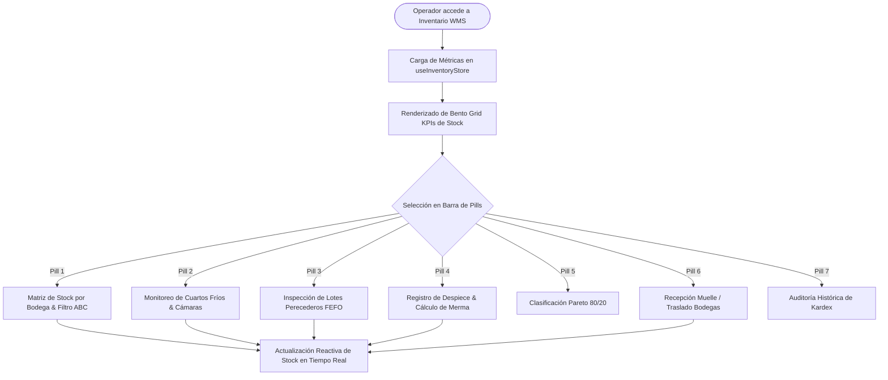
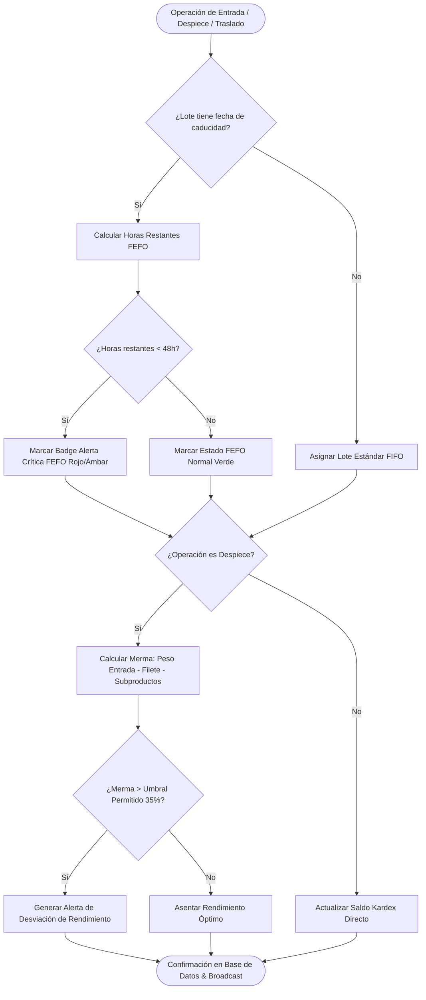
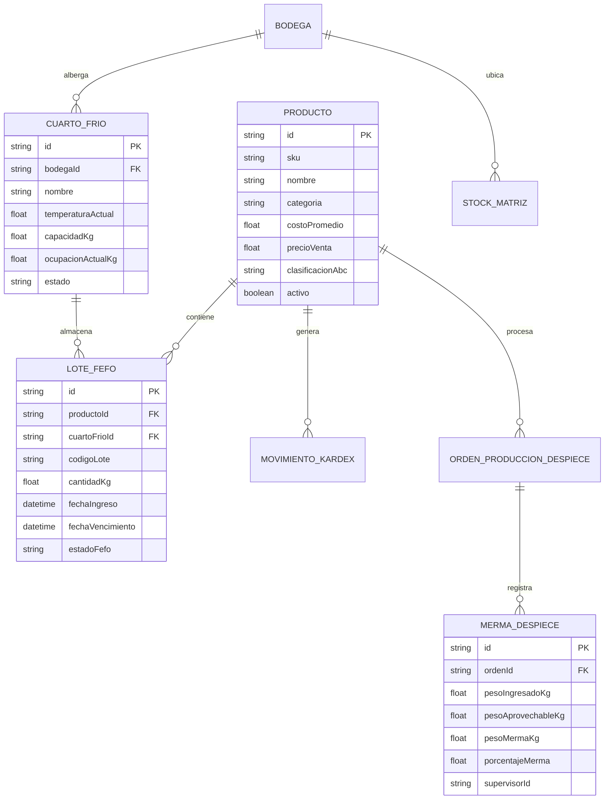
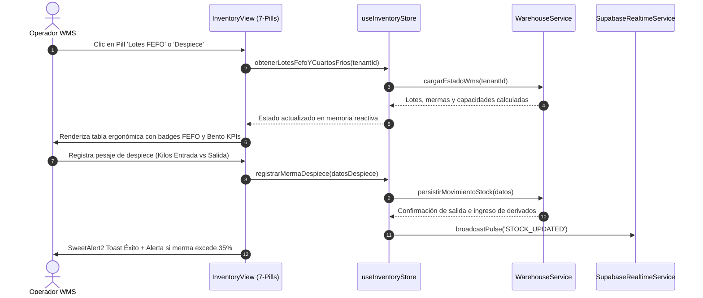
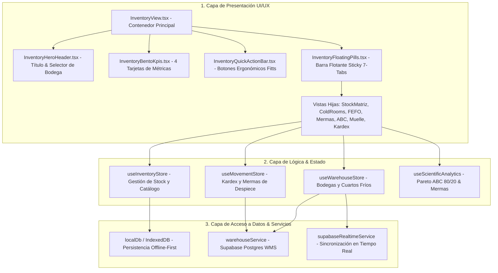

# Especificación Técnica: SPEC-048
## Reestructuración UI/UX Integral de Inventario & Bodega WMS (`InventoryView.tsx`)

- **Código:** SPEC-048
- **Fase:** Spec Kit SDD v3.0 — `/speckit.specify`
- **Gobernanza:** Flujo Continuo Kanban (`WIP = 1`). TDD Quirúrgico estricto.
- **Estado:** PENDIENTE DE APROBACIÓN DEL USUARIO

---

## 1. El "Qué" y el "Por Qué"

### 1.1 Contexto del Negocio y Problema
El módulo actual de Inventario (`InventoryView.tsx`) concentra múltiples responsabilidades operativas (catálogo maestro, matriz de stock, recepción en muelle, rendimiento de despiece, transferencias y análisis ABC) en un diseño extenso que sufre de sobrecarga cognitiva (Ley de Miller) y dificultad de navegación rápida para operadores de planta y cuartos fríos.

### 1.2 Solución Propuesta (SPEC-048)
Transformar `InventoryView.tsx` en un **Centro de Control Operativo WMS** de nivel premium que implementa:
1. **Bento Grid de KPIs en Tiempo Real:** 4 tarjetas compactas de alta jerarquía visual que resumen:
   - Valor Total de Inventario en Bodegas (`font-mono text-2xl`).
   - Ocupación & Temperatura Promedio de Cuartos Fríos (°C).
   - Lotes en Riesgo FEFO (< 48 hrs / por vencer).
   - Eficiencia de Despiece & Pareto ABC (Clase A al 80/20).
2. **Barra de Pestañas Flotante (Floating Pills Header - Ley de Hick):**  
   Navegación fluida por pastillas táctiles ergonómicas ($\ge 44\text{px}$) agrupadas por dominios operativos:
   - `Pestaña 1`: Matriz de Stock & Catálogo Maestro (`StockMatrizTable` + `ProductTable`).
   - `Pestaña 2`: Cuartos Fríos & Control de Cámaras (`ColdRoomPreparation`).
   - `Pestaña 3`: Trazabilidad de Lotes & Caducidad FEFO.
   - `Pestaña 4`: Rendimiento de Despiece & Mermas (`FishYieldProductionTab`).
   - `Pestaña 5`: Análisis ABC Pareto 80/20 (`AnalisisAbcWidget`).
   - `Pestaña 6`: Recepción en Muelle & Traslados Internos (`DockReceivingTab` + `WarehouseTransferPanel`).
   - `Pestaña 7`: Kardex & Auditoría de Movimientos (`KardexTable`).
3. **Barra de Acciones Rápidas (Quick Actions Bar - Ley de Fitts):** Acceso instantáneo a creación de producto, recepción de muelle, traslado entre bodegas e importación masiva.
4. **Paleta Cromática Dark Glassmorphism 60-30-10:**
   - **60% Fondo:** `bg-[#0B0F19]` y tarjetas translúcidas `bg-[#131C2E]/60 backdrop-blur-xl`.
   - **30% Estructura:** Bordes sutiles `border-slate-800/85` y tipografías `text-slate-100` / `text-slate-400`.
   - **10% Acentos:** Cian `#00F2FE` (activo/entradas), Ámbar `#F59E0B` (FEFO advertencia), Crimson `#EF4444` (merma/crítico) y Esmeralda `#10B981` (Pareto Clase A).

---

## 2. Multi-Phase System Modeling (5 Diagramas Mermaid)

### 2.1 Flujo de Procesos y Ciclo de Vida Secuencial (`1_process_flowcharts`)

---

### 2.2 Rombos de Decisión y Lógica de Edge Cases (`2_decision_logic_diagrams`)

---

### 2.3 Modelo Entidad-Relación (`3_entity_relationship_diagrams`)

---

### 2.4 Diagrama de Secuencia Temporal (`4_sequence_diagrams`)

---

### 2.5 Arquitectura por Capas (`5_component_architecture_diagrams`)

---

## 3. Scorecard de Cumplimiento de Leyes de UI

| Ley de UI | Aplicación Concreta en SPEC-048 |
| :--- | :--- |
| **Ley de Fitts** | Botones de acción rápida con altura mínima de $48\text{px}$, padding táctil amplio y botones principales anclados en zonas de fácil alcance visual. |
| **Ley de Hick** | Reducción de la carga cognitiva agrupando las 18 herramientas en **7 Pills principales** con íconos descriptivos y micro-conteos. |
| **Ley de Miller** | Cabecera ejecutiva limitada a exactamente **4 tarjetas Bento** (Stock, Frío, FEFO, Mermas) para no saturar la memoria de trabajo. |
| **Ley de Proximidad** | Agrupación visual de métricas de temperatura junto a la capacidad del cuarto frío, y porcentaje de merma junto a los kilos netos fileteados. |
| **Ley de Jakob** | Patrones de tablas de datos empresariales con cabeceras fijas (`sticky`), ordenamiento por columnas, badges semafóricos estándar y búsqueda instantánea. |
| **Contraste WCAG AAA** | Textos en `text-slate-100` sobre fondos `#0B0F19` y `#131C2E`, con ratio de contraste superior a $7:1$ y elementos interactivos en cian `#00F2FE` y esmeralda `#10B981`. |

---

## 4. Requerimientos de Calidad y Pruebas
1. **TDD:** Cobertura de pruebas unitarias $\ge 85\%$ en `src/tests/inventoryView7Tabs.test.tsx` y nuevas suites.
2. **TypeScript:** Cero errores en `tsc --noEmit` y cero uso de `any`.
3. **Bucle DevTools:** 0 errores/warnings en consola JS a 1280px y 375px móvil.
4. **Retrocompatibilidad:** Preservar la funcionalidad de las 7 pestañas existentes sin romper la persistencia de datos.

---

> [!IMPORTANT]
> **Check de Gobernanza SDD:** Por mandato constitucional, no se genera código hasta que el usuario apruebe esta especificación `/speckit.specify`.
