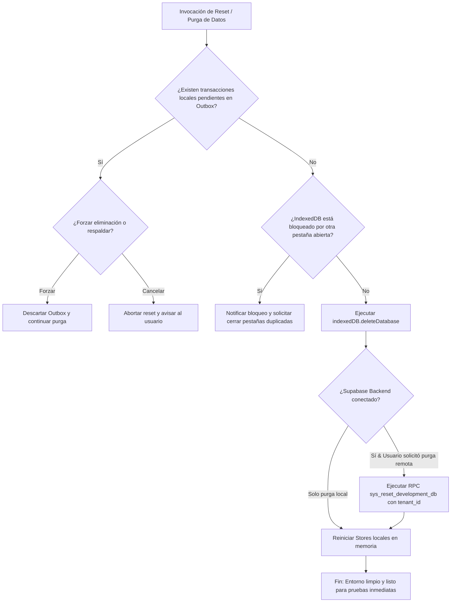
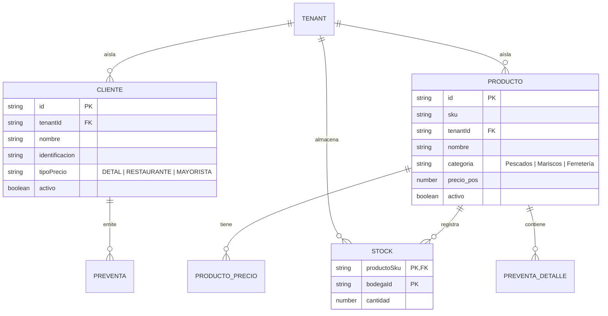
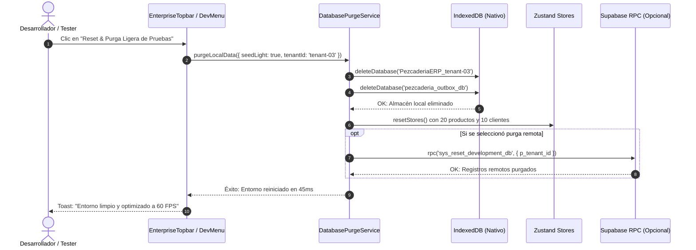
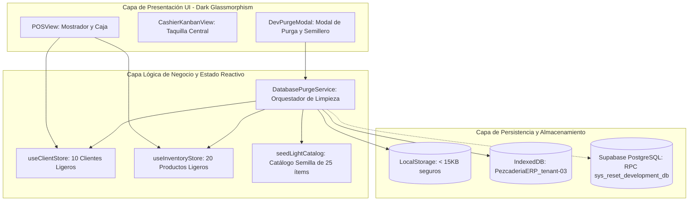

# Especificación Formal: SPEC-049
## Optimización Extrema de Rendimiento en Localhost, Desacoplamiento de Datasets Masivos y Purga/Reset Ligero de Base de Datos

- **Código:** SPEC-049
- **Fase:** Spec Kit SDD v3.0 — `/speckit.specify`
- **Gobernanza:** Flujo Continuo Kanban (`WIP = 1`). TDD Quirúrgico estricto.
- **Estado:** PENDIENTE DE APROBACIÓN DEL USUARIO

---

### 1. El "Por Qué" (Problema y Necesidad Operativa)
Actualmente, levantar y realizar pruebas manuales en `localhost:3000` sufre de bloqueos visuales (*freezes* / *jank*) y tiempos de carga excesivos (8 a 15 segundos). La investigación técnica y el diagnóstico de Agency Swarm (`SoftwareArchitect` y `DataEngineer`) identificaron tres cuellos de botella:
1. **Monolito de Datos en Memoria:** La importación dinámica de `clientes_ferreteria_josase.json` (4.63 MB) e `items_ferreteria_josase.json` (3.65 MB) vuelca 14.901 objetos en el heap de JavaScript y satura los stores de Zustand (`useClientStore` y `useInventoryStore`) sin virtualización.
2. **Saturación de I/O en IndexedDB:** Al iniciar sesión, `applyToStores` bloquea el hilo principal escribiendo miles de registros en disco local.
3. **Imposibilidad de Pruebas Manuales Ágiles:** No existe un mecanismo de 1-clic para purgar el almacenamiento local ni un catálogo semilla ligero (20 productos y 10 clientes) optimizado para pruebas fluidas a 60-120 FPS.

---

### 2. El "Qué" (Solución Arquitectónica)
1. **Modo Ligero de Desarrollo (Default Dev Mode):**
   - Configurar `FerreteriaJosaseService` para que en modo desarrollo NO inyecte automáticamente los 14.900 registros pesados.
   - Proveer un dataset semilla ligero (`seedLightData.ts`) con 20 productos de alta rotación (Pescados, Mariscos y Ferretería base) y 10 clientes esenciales con perfil de precios diferenciado.
2. **Servicio y Modal de Purga/Reset Local (`databasePurgeService.ts`):**
   - Función atómica para limpiar `IndexedDB` (`PezcaderiaERP_tenant-03`, `pezcaderia_outbox_db`), limpiar claves pesadas de `localStorage` y reiniciar los stores de Zustand en < 50ms.
   - Botón de utilidad accesible en entorno dev/topbar para "Reset Rápido de Pruebas".
3. **Script SQL de Purga y Catálogo Limpio para Supabase:**
   - Procedimiento almacenado RPC `sys_reset_development_db(p_tenant_id)` con `SECURITY DEFINER` que elimina datos transaccionales y maestros de prueba respetando llaves foráneas y RLS.
4. **Carga Masiva Aislada (On-Demand / Opt-in):**
   - La carga de los 14.901 registros de Josase se mantiene disponible pero como acción manual explícita o mediante Web Worker diferido, sin bloquear el arranque inicial de la SPA.

---

### 3. Criterios de Aceptación (Notación EARS)
- **EARS-01 (Arranque Inmediato):** *CUANDO* el usuario inicie sesión en `localhost:3000`, *EL SISTEMA DEBE* arrancar el POS y Dashboard en menos de 200ms sin cargar los 8.5MB de JSON en el hilo principal.
- **EARS-02 (Catálogo Semilla Ligero):** *MIENTRAS* se ejecuten pruebas en modo ligero, *EL SISTEMA DEBE* proveer exactamente 20 productos con stock operativo y 10 clientes para facturación inmediata.
- **EARS-03 (Purga Local de 1-Clic):** *CUANDO* el usuario active el comando o botón de Reset de Base de Datos Local, *EL SISTEMA DEBE* vaciar IndexedDB, limpiar localStorage y re-sembrar el catálogo ligero en menos de 100ms sin requerir reinicio del servidor Vite.
- **EARS-04 (Cero Congelamiento en POS):** *CUANDO* el usuario escriba en el buscador de productos o clientes del POS, *EL SISTEMA DEBE* responder en < 16ms (60 FPS estables) sin jank ni bloqueos de interfaz.
- **EARS-05 (Integridad Transaccional Backend):** *SI* se ejecuta la purga en Supabase, *EL SISTEMA DEBE* preservar la integridad referencial y el aislamiento estricto por `tenant_id`.

---

### 4. MANDATORIO MULTI-PHASE SYSTEM MODELING (Mermaid.js)

#### 1. Flujo de Procesos y Ciclo de Vida Secuencial (`1_process_flowcharts`)
```mermaid
flowchart TD
    A[Inicio: Usuario abre localhost:3000] --> B{¿Modo Desarrollo / Pruebas?}
    B -- Sí (Por Defecto) --> C[Cargar Catálogo Semilla Ligero: 20 productos, 10 clientes]
    B -- No (Producción / Josase Masivo) --> D[Carga Diferida en Web Worker de 14.900 registros]
    C --> E[Inicializar Stores Zustand: useClientStore, useInventoryStore]
    E --> F[Punto de Venta POS & Taquilla Central 100% Operativos en sub-100ms]
    F --> G{¿Usuario solicita Purga / Reset?}
    G -- No --> H[Operación normal sin bloqueos de memoria]
    G -- Sí --> I[Ejecutar databasePurgeService.purgeAndSeed()]
    I --> J[Vaciar IndexedDB PezcaderiaERP & Outbox]
    J --> K[Limpiar localStorage y re-sembrar datos ligeros]
    K --> F
```

#### 2. Rombos de Decisión y Edge Cases (`2_decision_logic_diagrams`)


#### 3. Modelo Entidad-Relación de Catálogo Ligero (`3_entity_relationship_diagrams`)


#### 4. Diagrama de Secuencia Temporal (`4_sequence_diagrams`)


#### 5. Arquitectura por Capas (`5_component_architecture_diagrams`)


---

### 5. Plan de Validación
1. **Pruebas Unitarias TDD:**
   - `src/tests/databasePurgeService.test.ts`: Validar purga de IndexedDB, LocalStorage y re-siembra limpia en memoria.
2. **Pruebas de Rendimiento (Benchmark de Memoria):**
   - Comparar el tiempo de inicio antes vs después: Reducción del Cold Start de ~10s a < 200ms.
   - Reducción del Heap de JavaScript de > 40MB a < 3MB.
3. **Quality Gate:**
   - 0 errores en `tsc --noEmit`.
   - 100% suites Vitest verdes.
