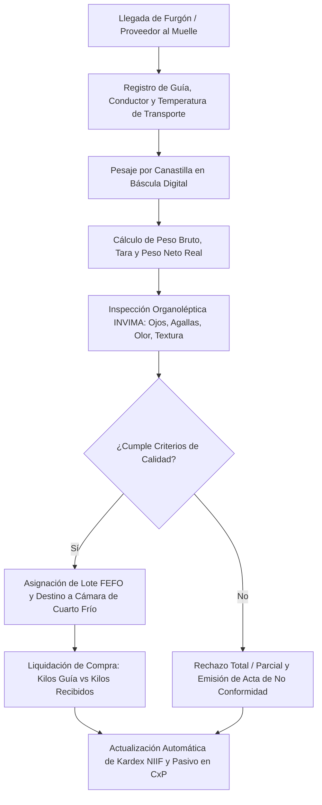
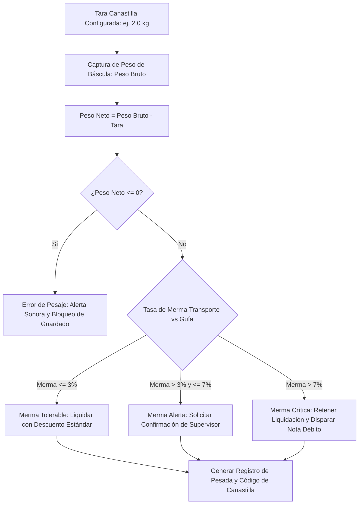
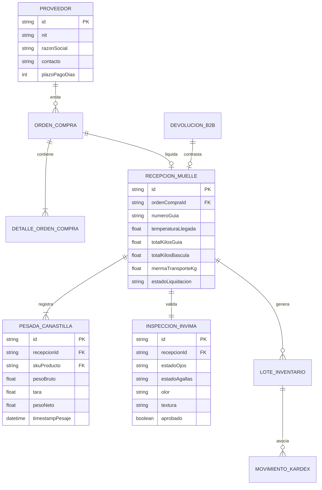
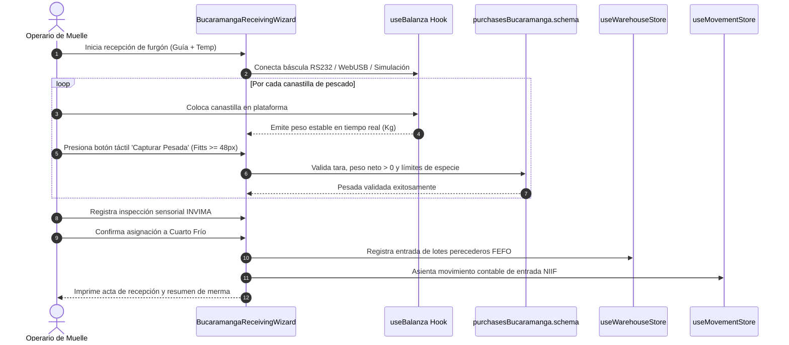
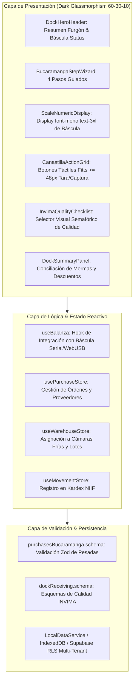

# Especificación Técnica del Requerimiento: SPEC-050
## Reestructuración UI/UX Integral de Compras, Recepción en Muelle & Devoluciones B2B

- **Código:** SPEC-050
- **Fase:** Spec Kit SDD v3.0 — `/speckit.specify`
- **Gobernanza:** Flujo Continuo Kanban (`WIP = 1`). TDD Quirúrgico estricto.
- **Estado:** PENDIENTE DE APROBACIÓN DEL USUARIO

---

## 1. Declaración del Problema & Propósito

### 1.1 El "Qué" se va a construir
Una reestructuración arquitectónica y de experiencia de usuario (UI/UX) para todo el subsistema de abastecimiento y muelle del ERP de La Pezcadería:
1. **Recepción en Muelle & Furgón Bucaramanga (`BucaramangaReceivingWizard.tsx` & `DockReceivingTab.tsx`):**
   - Wizard por pasos (1. Datos del Furgón/Guía $\rightarrow$ 2. Pesaje Dinámico por Canastilla $\rightarrow$ 3. Control Organoléptico INVIMA $\rightarrow$ 4. Destino a Cuartos Fríos).
   - Ergonomía táctil industrial para operarios con guantes en ambiente húmedo (Ley de Fitts con botones $\ge 48\text{px} - 64\text{px}$ para *Tara*, *Capturar Peso*, *Siguiente Canastilla*).
   - Display de báscula en `font-mono text-3xl font-black` de alto contraste.
2. **Órdenes de Compra & Abastecimiento (`PurchaseOrderForm.tsx` & `PurchasesReport.tsx`):**
   - Comparativo de tolerancia de merma en transporte: Kilos en Guía vs Kilos en Báscula vs Kilos Netos Facturados.
   - Generación de cuentas por pagar y notas débito/crédito por faltantes.
3. **Recepción de Devoluciones B2B (`ReturnsReceiver.tsx`):**
   - Flujo de control de calidad para rechazos de clientes: ingreso a cuarentena, re-pesaje y resolución (reingreso a inventario, despiece secundario o merma por avería).

### 1.2 El "Por qué"
- Las interfaces de recepción en muelle requieren una velocidad de captura extrema para no cortar la cadena de frío del pescado fresco.
- El personal de bodega opera básculas electrónicas en condiciones de frío y humedad; interfaces con botones pequeños provocan errores de digitación y demoras en el descargue.
- La conciliación de mermas de viaje entre Bucaramanga y Bogotá exige cálculo determinista instantáneo para evitar pérdidas financieras con proveedores.

---

## 2. Modelado de Sistema Multifase (Mermaid.js)

### Diagrama 1: Flujo de Procesos y Ciclo de Vida Secuencial (1_process_flowcharts)

---

### Diagrama 2: Lógica de Decisión y Tolerancias de Merma (2_decision_logic_diagrams)

---

### Diagrama 3: Modelo Entidad-Relación (3_entity_relationship_diagrams)

---

### Diagrama 4: Diagrama de Secuencia Temporal (4_sequence_diagrams)

---

### Diagrama 5: Arquitectura de Componentes por Capas (5_component_architecture_diagrams)

---

## 3. Scorecard de Principios UI/UX (Leyes Cognitivas)

| Ley / Principio | Aplicación en el Módulo de Muelle & Compras |
| :--- | :--- |
| **Ley de Fitts** | Botones de acción principal en báscula (*Tara*, *Capturar*, *Siguiente*) con altura $\ge 48\text{px} - 64\text{px}$, separados para operarios con guantes. |
| **Ley de Miller** | Wizard estructurado en 4 fases secuenciales claramente separadas, evitando pantallas sobrecargadas. |
| **Ley de Hick** | Acciones inmediatas en pantalla limitadas a un flujo lineal de 1 a 2 decisiones por paso. |
| **Ley de Proximidad** | Datos de báscula agrupados visualmente: Peso Bruto, Tara y Peso Neto en un marco unificado. |
| **Regla 60-30-10** | Fondo Void Deep Blue (`#0B0F19`), tarjetas translúcidas Slate (`#131C2E`), acento cian `#00F2FE` (báscula activa), verde `#10B981` (pesada correcta) y rojo `#EF4444` (merma crítica o rechazo INVIMA). |
| **WCAG 2.1 AAA** | Contraste de texto numérico $\ge 7:1$ sobre fondo oscuro con tipografía `font-mono`. |

---

## 4. Criterios de Aceptación Preceptivos

1. **Flujo de Recepción sin Fricción:** El wizard de 4 pasos debe permitir registrar un furgón completo con hasta 50 canastillas sin recarga de página ni caídas de rendimiento (< 16ms por fotograma, 120 FPS).
2. **Cálculo Determinista de Mermas:** Diferencia entre peso en guía y peso en báscula calculada automáticamente con semáforo verde ($\le 3\%$), ámbar ($3\% - 7\%$) y rojo ($> 7\%$).
3. **Cero Regresiones:** Los tests existentes en `bucaramangaReceivingWizard.test.tsx` (10/10) deben seguir pasando al 100%.
4. **Verificación DevTools MCP:** 0 errores fatales en consola JS y visualización correcta a 1280px y 375px móvil.
