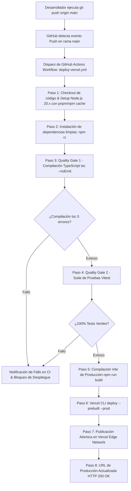
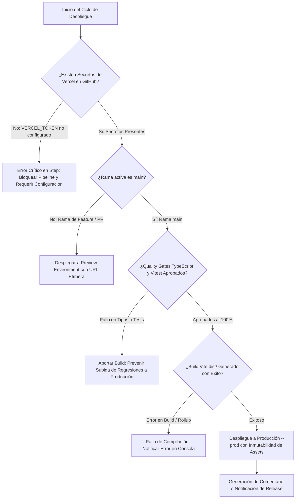
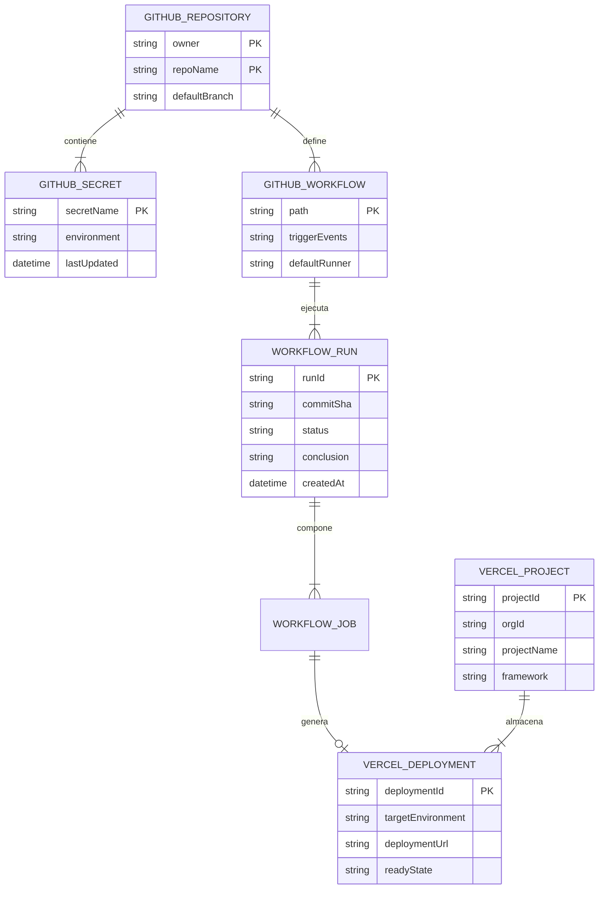
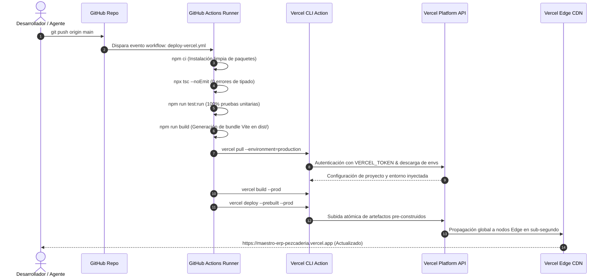
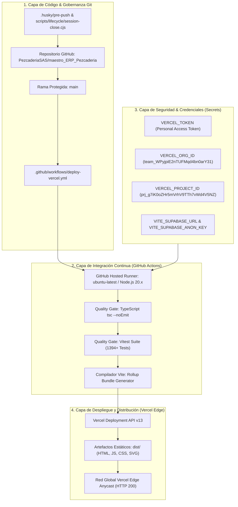

# Especificación Técnica del Requerimiento: SPEC-051
## Pipeline Automatizado de CI/CD para Despliegue Continuo en Vercel con GitHub Actions

- **Código:** SPEC-051
- **Fase:** Spec Kit SDD v3.0 — `/speckit.specify`
- **Gobernanza:** Flujo Continuo Kanban (`WIP = 1`). TDD Quirúrgico estricto.
- **Estado:** PENDIENTE DE APROBACIÓN DEL USUARIO

---

## 1. Declaración del Problema & Propósito

### 1.1 El "Qué" se va a construir
Una infraestructura de entrega continua (CI/CD) completamente automatizada, segura y verificable para **La Pezcadería ERP**, compuesta por:
1. **GitHub Actions Workflow Oficial (`.github/workflows/deploy-vercel.yml`):**
   - Disparo automático ante cada `push` a la rama `main` y soporte para ejecución manual bajo demanda (`workflow_dispatch`).
   - **Quality Gate Pre-Despliegue:** Validación estricta de tipos TypeScript (`tsc --noEmit` con 0 errores) y ejecución de pruebas unitarias (`vitest run` al 100% pasando).
   - **Compilación Optimizada:** Construcción limpia del bundle SPA (`npm run build` $\rightarrow$ `dist/`) con cabeceras de caché inmutable para assets en `vercel.json`.
   - **Despliegue a Producción Vercel:** Despliegue atómico a la red Edge de Vercel con vinculación estricta al proyecto (`prj_g7iK0oZHr5mVrhV9TTh7vWd4V5NZ`) y organización (`team_WPyjpiE2nTUFMqd4bn0arY31`).
2. **Script de Despliegue Local Resiliente (`scripts/lifecycle/deploy-vercel.cjs` y comando `npm run deploy:vercel`):**
   - Permite a los desarrolladores o agentes desplegar a producción o preview desde la terminal local previa verificación de credenciales y ejecución de quality gates.
3. **Guía de Configuración de Secretos en GitHub:**
   - Mapeo exacto de las variables requeridas en GitHub Secrets (`VERCEL_TOKEN`, `VERCEL_ORG_ID`, `VERCEL_PROJECT_ID`, variables de Supabase y Redis para compilación Vite).

### 1.2 El "Por qué"
- Actualmente, el despliegue en producción ([https://maestro-erp-pezcaderia.vercel.app/](https://maestro-erp-pezcaderia.vercel.app/)) está congelado en el build del **28 de Octubre de 2026** (`index-Cv3QPOzP.js`), careciendo de los módulos implementados en las especificaciones `SPEC-041` a `SPEC-050` (Flujo Multivendedor, Caja Única, Compras en Muelle, Display Báscula, Checklist INVIMA y Conciliación de Mermas).
- El repositorio no posee el directorio `.github/workflows/`, por lo que los comandos `git push origin main` no generan ninguna acción de despliegue.
- El token CLI local expiró, requiriendo un mecanismo robusto y desatendido que no dependa de sesiones interactivas que caducan.

---

## 2. Modelado de Sistema Multifase (Mermaid.js)

### Diagrama 1: Flujo de Procesos y Ciclo de Vida Secuencial (1_process_flowcharts)

---

### Diagrama 2: Lógica de Decisión y Guardas de Despliegue (2_decision_logic_diagrams)

---

### Diagrama 3: Modelo Entidad-Relación de Configuración CI/CD (3_entity_relationship_diagrams)

---

### Diagrama 4: Diagrama de Secuencia Temporal (4_sequence_diagrams)

---

### Diagrama 5: Arquitectura de Componentes por Capas (5_component_architecture_diagrams)

---

## 3. Especificación Técnica de los Componentes a Crear

### 3.1 Archivo de Workflow de GitHub Actions: `.github/workflows/deploy-vercel.yml`
- **Disparadores:**
  - `push` en ramas `main`.
  - `workflow_dispatch` (permite disparar despliegues manuales desde la pestaña Actions de GitHub con un clic).
- **Entorno de Ejecución:** `ubuntu-latest`, `node-version: 20.x`.
- **Pasos:**
  1. `actions/checkout@v4` con fetch-depth completo (`fetch-depth: 0`).
  2. `actions/setup-node@v4` con caché de `npm`.
  3. Instalación de dependencias: `npm ci`.
  4. Verificación estricta de tipos: `npx --no-install tsc --noEmit`.
  5. Verificación de pruebas unitarias: `npm run test:run`.
  6. Instalación de Vercel CLI global: `npm install --global vercel@latest`.
  7. Extracción de configuración de entorno Vercel:
     `vercel pull --yes --environment=production --token=${{ secrets.VERCEL_TOKEN }}`
  8. Construcción de artefactos de producción:
     `vercel build --prod --token=${{ secrets.VERCEL_TOKEN }}`
  9. Despliegue final con artefactos precompilados:
     `vercel deploy --prebuilt --prod --token=${{ secrets.VERCEL_TOKEN }}`

### 3.2 Script de Despliegue Local Asistido: `scripts/lifecycle/deploy-vercel.cjs`
- **Propósito:** Ofrecer un comando directo `npm run deploy:vercel` para que el desarrollador pueda desplegar de inmediato sin esperar a GitHub o diagnosticar el estado del token.
- **Acciones:**
  1. Verifica si `VERCEL_TOKEN` está en `.env.local` o `process.env`. Si no está, guía al usuario interactivamente para obtenerlo.
  2. Ejecuta `tsc --noEmit` y `vitest run`.
  3. Ejecuta `npx vercel --prod --token=...`.
  4. Valida con una petición HTTP `GET` que `https://maestro-erp-pezcaderia.vercel.app/` responda en HTTP 200 y reporte el nuevo hash del bundle.

### 3.3 Configuración en `package.json`
- Añadir comando `npm run deploy:vercel` mapeado a `node scripts/lifecycle/deploy-vercel.cjs`.

---

## 4. Criterios de Aceptación Innegociables

1. **Automatización:** Cada `git push origin main` debe iniciar el workflow de GitHub Actions sin intervención manual.
2. **Quality Gate:** Si una prueba unitaria falla o `tsc` tiene 1 error, el pipeline DEBE abortar inmediatamente e impedir que el código roto llegue a producción.
3. **Producción Actualizada:** Tras la ejecución, `https://maestro-erp-pezcaderia.vercel.app/` debe servir el bundle con las especificaciones SPEC-041 a SPEC-050 incluidas.
4. **Resiliencia Local:** El desarrollador debe poder desplegar localmente en cualquier momento ejecutando `npm run deploy:vercel`.

