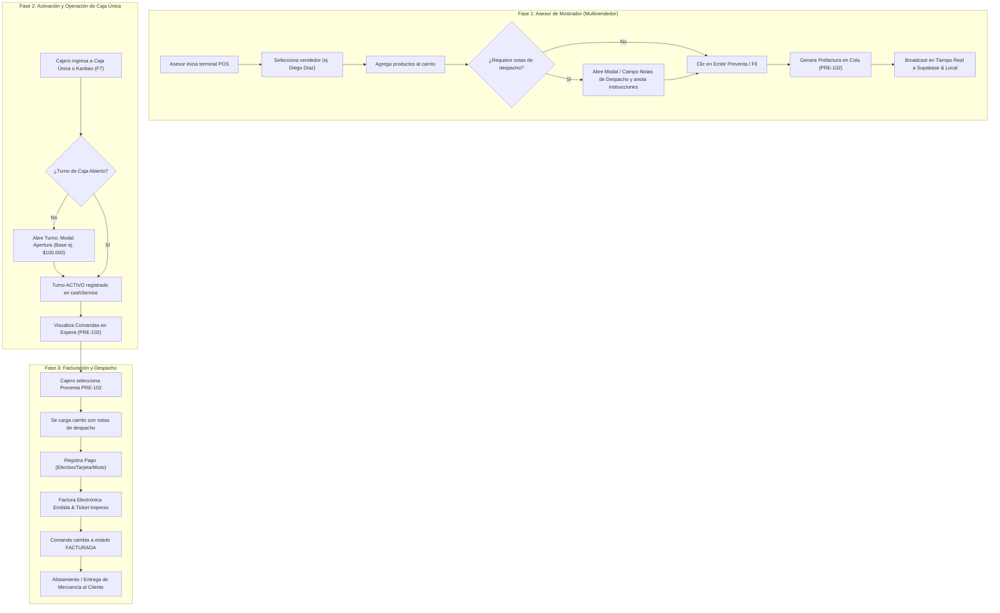
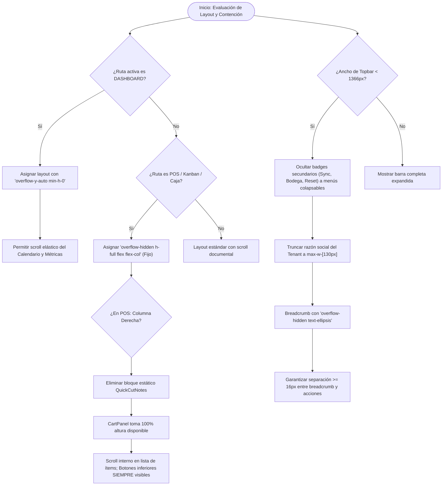
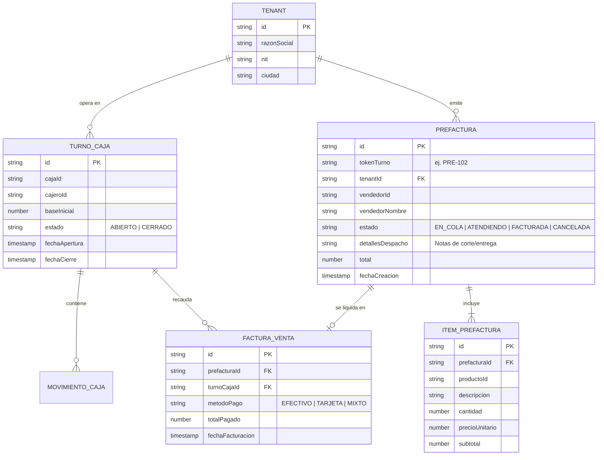
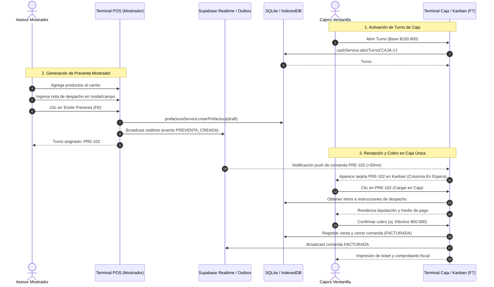
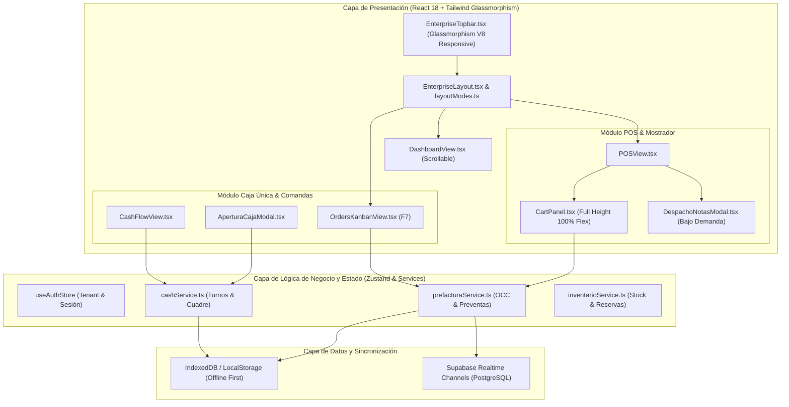

# SPEC-052: Corrección Integral de UI/UX Frontend, Descongelamiento de Dashboard, Ergonomía de Carrito POS y Activación de Caja Multivendedor

## 1. Contexto y Objetivos (¿Qué y Por Qué?)

### 1.1 Problemas Detectados en Producción
A partir de la auditoría de despliegue en Vercel y el reporte de uso en producción (con evidencia gráfica en `media_1793808321187_720a4430.jpg`), se identificaron cuatro anomalías críticas que impactan severamente la operabilidad del ERP:

1. **Dashboard Congelado (Scroll Bloqueado)**:
   - **Causa Raíz**: En `src/components/layout/layoutModes.ts`, `AppRouteId.DASHBOARD` fue catalogado indebidamente dentro de `TRANSACTIONAL_FIXED_VIEWS`. Esto inyecta `overflow-hidden` y una altura fija restrictiva al contenedor `<main>`, bloqueando el desplazamiento vertical del calendario, los gráficos y las tarjetas métricas del Dashboard en cualquier resolución.
   - **Objetivo**: Descongelar el Dashboard permitiendo scroll vertical elástico natural (`overflow-y-auto min-h-0`), sin afectar el layout rígido requerido exclusivamente para vistas transaccionales como POS o Kanban.

2. **Panel POS: Eliminación de "Corte y Preparación de Mostrador" y Rescate de Espacio Vertical**:
   - **Causa Raíz**: En `src/views/POSView.tsx` (líneas 2652-2661), la columna derecha renderiza de forma estática el componente `QuickCutNotes` ("Corte y Preparación de Mostrador (1 Toque)") con 6 botones masivos que consumen ~160px de altura vertical fija. Esto comprime el `CartPanel`, provocando que la lista de productos quede reducida a un espacio minúsculo y que los botones de acción inferior (`Cerrar Turno`, `En Espera (F6)`, `Borrar Carrito`, `Cobrar`) queden amputados o cortados contra el borde inferior de la pantalla.
   - **Objetivo**: Suprimir de forma definitiva la sección fija `QuickCutNotes`. En su lugar, proporcionar un modal ergonómico bajo demanda (o el campo expandible de notas existente) para anotar especificaciones de alistamiento/despacho, permitiendo que el Carrito POS recupere el 100% de la columna derecha y mantenga visibles y accesibles todos los botones de acción inferior.

3. **Flujo de Activación de Caja y Pruebas Manuales Multivendedor $\rightarrow$ Caja Única**:
   - **Requerimiento**: El usuario necesita una guía clara, operable y verificada para activar la caja, comprender el ciclo de vida del turno y realizar pruebas manuales completas del modelo *Multivendedor (Mostrador) $\rightarrow$ Preventas (Comandas) $\rightarrow$ Caja Única (Cobro y Facturación)*.
   - **Objetivo**: Documentar exhaustivamente el procedimiento operativo, validar que el estado de apertura/cierre de turno se refleje sin ambigüedad en la UI, y verificar la reactividad en tiempo real de la transición de preventas en cola (`EN_COLA` / `EMITIDA`) hacia su cobro en caja (`FACTURADA`).

4. **Desbordamientos Visuales y Colisión Topbar**:
   - **Causa Raíz**: En `src/components/layout/EnterpriseTopbar.tsx`, el contenedor flex de la barra superior sufre una colisión grave cuando la pantalla tiene resoluciones de laptop estándar ($\le 1366\text{px}$). La sección derecha (`shrink-0`) contiene 9 elementos fijos que acumulan más de 1.050px de ancho forzado. Al no poder encogerse, el contenedor izquierdo (`flex-1 min-w-0`) se reduce a 0px; el texto del breadcrumb (`Ventas & Comercial`), carente de contención elíptica en su envoltorio, se desborda y se dibuja directamente encima del botón selector de empresa (`Ferretería & Eléctricos Josase`), generando un solapamiento tipográfico ilegible.
   - **Objetivo**: Rediseñar la distribución del `EnterpriseTopbar` aplicando prioridades de visibilidad responsive (`hidden xl:flex`, `hidden 2xl:flex`), truncamiento estricto con elipsis (`truncate`) y contención de desbordamiento (`overflow-hidden`), garantizando cero colisiones tipográficas en cualquier ancho de pantalla desde 1024px hasta 4K.

---

## 2. Modelado de Sistema Multi-Fase (5 Diagramas Mermaid Mandatorios)

### 2.1 Diagrama 1: Flujo de Procesos y Ciclo de Vida Secuencial (Process Flowchart)

### 2.2 Diagrama 2: Lógica de Decisión y Edge Cases (Decision Logic)

### 2.3 Diagrama 3: Modelo Entidad-Relación (ERD)

### 2.4 Diagrama 4: Secuencia Temporal Multivendedor $\rightarrow$ Caja Única

### 2.5 Diagrama 5: Arquitectura de Componentes de Frontend por Capas

---

## 3. Especificación Técnica de los 4 Requerimientos

### 3.1 Requerimiento 1: Descongelamiento del Dashboard y Calendario
- **Archivo afectado**: `src/components/layout/layoutModes.ts`.
- **Modificación**:
  - Remover `AppRouteId.DASHBOARD` de la constante `TRANSACTIONAL_FIXED_VIEWS`.
  - Asegurar que `getMainLayoutClasses(AppRouteId.DASHBOARD)` retorne:
    `flex-1 px-2.5 pb-2 lg:px-3 lg:pb-2.5 pt-0 overflow-y-auto custom-scrollbar min-h-0`.
- **Criterio de Aceptación**: En resolución 1366x768 y 1920x1080, la vista del Dashboard permite desplazarse verticalmente hasta el final de la pantalla, visualizando el calendario completo y las métricas sin truncamiento.

### 3.2 Requerimiento 2: Remoción de "Corte y Preparación" y Rescate Ergonómico del POS
- **Archivos afectados**: `src/views/POSView.tsx`, `src/views/pos/components/CartPanel.tsx`.
- **Modificaciones**:
  - Eliminar el bloque JSX que renderiza `QuickCutNotes` en `POSView.tsx:2653-2661`.
  - En su lugar, el `CartPanel` pasa a recibir la altura completa disponible de la columna (`flex-1 min-h-0`).
  - Habilitar un modal o botón flotante ergonómico "📝 Notas de Despacho" integrado limpiamente en el flujo de preventa (`F6`), sin ocupar espacio estático permanente.
  - Asegurar que en `CartPanel.tsx` la sección de lista de ítems tenga `flex-1 min-h-0 overflow-y-auto`, y que el pie de página con los botones de acción (`Cerrar Turno`, `En Espera (F6)`, `Cobrar / Pagar`) tenga posición fija al fondo del panel y **nunca sea recortado**.

### 3.3 Requerimiento 3: Activación y Procedimiento de Caja Multivendedor
- **Flujo Documentado y Probado**:
  1. **Apertura de Caja**:
     - Vía estándar: Entrar al módulo **Caja** (`cash-flow` o `/caja`) o hacer clic en "Abrir Turno" en el POS. Ingresar base (ej. $100.000) en `AperturaCajaModal.tsx`.
     - Vía rápida de prueba (1 toque): Clic en el botón `🔨 Josase ⇄` en el Topbar, el cual conmuta a Ferretería Josase y ejecuta apertura automática de `'CAJA-1'` con $100.000 base y 3 preventas semilla.
  2. **Emisión de Preventa (Mostrador)**:
     - El vendedor selecciona productos $\rightarrow$ clic en `Emitir Preventa (F6)` $\rightarrow$ el pedido queda en espera con código `PRE-XXX`.
  3. **Cobro y Facturación en Caja Única**:
     - El cajero pulsa `F7` (o botón "Kanban Caja F7" en Topbar) $\rightarrow$ visualiza las comandas activas $\rightarrow$ hace clic sobre la comanda para cobrarla $\rightarrow$ selecciona método de pago $\rightarrow$ Factura POS generada exitosamente.

### 3.4 Requerimiento 4: Solución Definitiva de Desbordamientos y Colisión en Topbar
- **Archivo afectado**: `src/components/layout/EnterpriseTopbar.tsx`.
- **Modificaciones**:
  - **Envoltorio Izquierdo (Breadcrumb)**:
    - Aplicar `overflow-hidden` al contenedor del breadcrumb.
    - Ocultar `breadcrumb.domain` en pantallas menores a 1280px (`hidden xl:inline`).
    - Truncar `breadcrumb.sub` con `max-w-[120px] sm:max-w-[180px] truncate`.
  - **Envoltorio Derecho (Acciones y Botones)**:
    - Remover `shrink-0` forzado que expulsa al breadcrumb.
    - Aplicar `overflow-hidden` o prioridad de visualización:
      - Selector de Tenant: `max-w-[130px] truncate`.
      - Selector de Bodega: `hidden 2xl:flex`.
      - Botón Reset DB: `hidden xl:flex`.
      - Badges de red y atajos: distribución elástica con `gap-1.5 sm:gap-2`.
    - Garantizar que la barra mantenga `h-12`, padding lateral equilibrado y separación mínima de 16px entre la sección izquierda y derecha.

---

## 4. Matriz de Verificación y Pruebas Unitarias
- `layoutModes.test.ts`: Verificar que `getMainLayoutClasses('dashboard')` contiene `overflow-y-auto` y NO `overflow-hidden`.
- `posCartPanelErgonomics.test.tsx`: Validar renderizado de carrito a altura completa sin colisión de botones inferiores.
- `enterpriseTopbarA11yV8.test.tsx`: Validar que no existan desbordamientos tipográficos en 1024px, 1280px y 1920px.
- Verificación en navegador y bucle DevTools: Captura y revisión a 1280x800 y 375x667.

