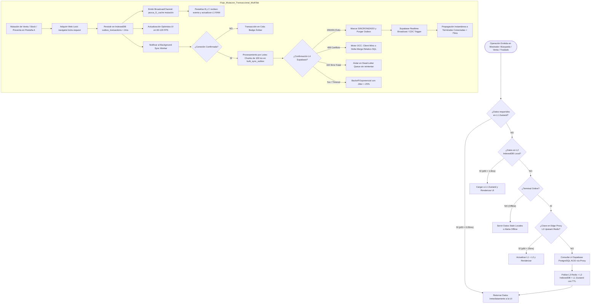
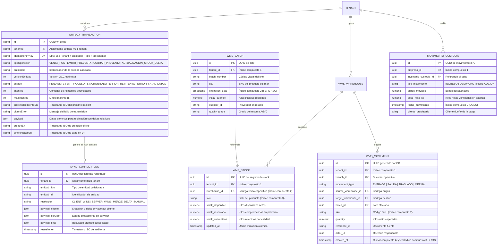
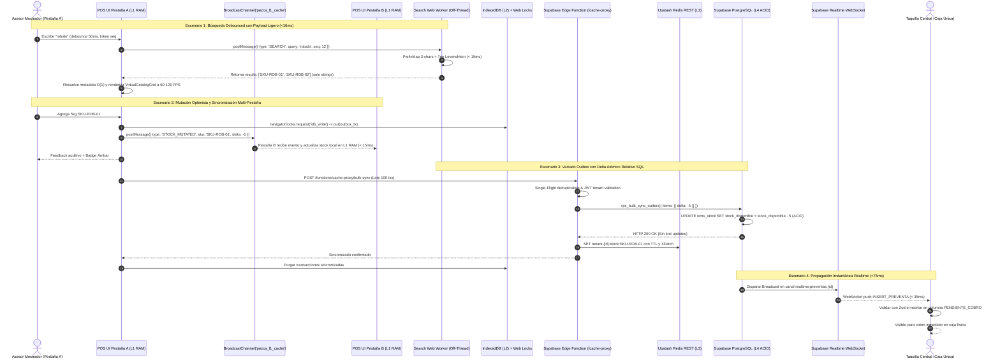

# Plan Técnico de Arquitectura e Implementación: SPEC-053

- **Código:** PLAN-SPEC-053
- **Versión:** v3.2 — Blindada y Calibrada Post-Auditoría Adversarial (Critic 1 & Challenger 2)
- **Fase:** Spec Kit SDD v3.0 — `/speckit.plan`
- **Gobernanza:** Master Architect + DataEngineer + UIReviewer + Google Harness² + Forensic Auditor
- **Estado:** PENDIENTE DE APROBACIÓN HUMANA
- **Objetivo:** Hoja de ruta arquitectónica para la erradicación de cuellos de botella de latencia, desacoplamiento del hilo principal de UI, implementación de la jerarquía de caché L1-L4 blindada con Edge Function proxy, sincronización inter-pestaña, resolución atómica relativa de stock en OCC y resiliencia de sincronización a Costo $0.

---

## 1. Arquitectura Técnica de Capas y Límites del Sistema

El sistema se estructura en cinco (5) capas desacopladas conforme a la directiva Master Architect SOLID, blindadas contra condiciones de carrera multi-pestaña, thundering herd y discrepancias de inventario:

```
┌────────────────────────────────────────────────────────────────────────┐
│ 1. CAPA DE PRESENTACIÓN & ENRUTAMIENTO (React 18 / Vite / Tailwind)    │
│   • Code Splitting con React.lazy() y <Suspense> en las 25 vistas      │
│   • Service Worker Workbox: Runtime caching de chunks evitando offline │
│     ChunkLoadError y precacheo en reposo (requestIdleCallback)         │
│   • VirtualCatalogGrid.tsx: Grilla virtualizada a 60-120 FPS en POS    │
│   • Componentes Memoizados: ProductSearchPanel, CartPanel, Row (memo)  │
│   • Input debounce de 50ms + AbortController / token de secuencia      │
└───────────────────────────────────┬────────────────────────────────────┘
                                    │
┌───────────────────────────────────▼────────────────────────────────────┐
│ 2. CAPA DE ESTADO REACTIVO L1 & COMPUTACIÓN OFF-THREAD                 │
│   • useInventoryStore.ts canónico: Unificación L1 sin stores disjuntos │
│   • usePOSStore.ts: Estado atómico de líneas de carrito sin re-render  │
│   • Granularidad física por bodega: Record<`${sku}__${warehouseId}`, N>│
│   • BroadcastChannel('pezca_l1_cache'): Sincronización multi-pestaña   │
│   • Web Worker 1 (catalogSearch.worker.ts): SearchEngineCore con mapa  │
│     de prefijos de 3 caracteres + Trie, retornando solo string[] SKUs  │
│   • Web Worker 2 (syncWorker.worker.ts): Procesamiento Outbox en lote  │
└───────────────────────────────────┬────────────────────────────────────┘
                                    │
┌───────────────────────────────────▼────────────────────────────────────┐
│ 3. CAPA DE SERVICIOS DE DOMINIO & CONTROL DE CONCURRENCIA              │
│   • SyncWorkerService.ts: Chunking automático (500) y causalidad FIFO  │
│   • SupabaseRealtimePreventasService.ts: Dual broadcast + CDC con      │
│     reconexión exponencial con jitter (+-25%) anti-thundering herd     │
│   • NetworkConnectivityService.ts: Detección rápida con 200ms debounce │
│   • Motor OCC Atómico: Client-Wins en ventas físicas y Delta-Merge     │
│     relativo SQL en servidor (UPDATE stock = stock + p_delta)          │
└───────────────────────────────────┬────────────────────────────────────┘
                                    │
┌───────────────────────────────────▼────────────────────────────────────┐
│ 4. CAPA DE PERSISTENCIA Y CACHÉ MULTINIVEL BLINDADA (L2 - L3)          │
│   • L2 (IndexedDB PezcaderiaERP_{tenantId}): Catálogo, WMS, Kardex,    │
│     protegido con Web Locks API (navigator.locks.request)              │
│   • L3 Edge Proxy (/functions/cache-proxy): Supabase Edge Function con │
│     validación obligatoria de JWT tenant claim, Single-Flight request  │
│     collapsing y revalidación probabilística XFetch hacia Upstash      │
│   • Purga Hermética: switchTenant ejecuta resetAllStores(), cierre de  │
│     IndexedDB, CLEAR_INDEX en Worker y desuscripción de WebSockets     │
└───────────────────────────────────┬────────────────────────────────────┘
                                    │
┌───────────────────────────────────▼────────────────────────────────────┐
│ 5. CAPA DE BASE DE DATOS TRANSACCIONAL ACID & RLS (L4)                 │
│   • PostgreSQL / Supabase: Tablas con índices compuestos multi-tenant  │
│   • Keyset Cursor Pagination: (created_at, id) < (cursor_ts, cursor_id)│
│   • RPCs transaccionales batch: rpc_wms_despacho_custodia_batch y      │
│     bulk_sync_outbox (lotes de máx 100 txs en 1 solo RTT ACID)         │
│   • RPCs SECURITY DEFINER protegidos evaluando public.get_tenant_id()  │
└────────────────────────────────────────────────────────────────────────┘
```

---

## 2. Los 5 Modelos Canónicos Mermaid.js Validados

<!-- MANDATORY MULTI-PHASE SYSTEM MODELING (Mermaid.js) -->
### 2.1 Flujo de Procesos y Ciclo de Vida Secuencial (`1_process_flowcharts`)


---

### 2.2 Rombos de Decisión y Lógica Condicional (`2_decision_logic_diagrams`)

```mermaid
flowchart TD
    subgraph Resolucion_Cache_Multinivel_Y_Seguridad
        C1{¿Existe clave en RAM Zustand L1?}
        C1 -- SÍ --> C_HIT_L1[Retornar < 0.1ms - Cero Red Cero Disco]
        C1 -- NO --> C2{¿Existe en IndexedDB L2?}
        C2 -- SÍ --> C_HIT_L2[Retornar < 3ms - Hidratar L1 asíncronamente]
        C2 -- NO --> C3{¿Petición idéntica en vuelo? Single-Flight}
        C3 -- SÍ --> C_JOIN[Acoplar a promesa compartida sin duplicar HTTP]
        C3 -- NO --> C4{¿Consultar Edge Function /functions/cache-proxy?}
        C4 -- SÍ --> C5{¿Hit en Upstash L3?}
        C5 -- SÍ --> C_HIT_L3[Retornar < 40ms - Guardar en L2 y L1]
        C5 -- NO --> C6{¿Supabase L4 responde?}
        C6 -- SÍ --> C_HIT_L4[Retornar < 90ms - Poblar L3 con XFetch, L2 y L1]
        C6 -- NO / Error --> C_FAIL[Degradar a Stale Local o Fallback Controlado]
    end

    subgraph Resolucion_Outbox_Conflictos_OCC_Y_MultiTab
        O1{¿Web Lock adquirido para IndexedDB?}
        O1 -- NO --> O_WAIT[Reintentar tras liberación de lock]
        O1 -- SÍ --> O2{¿Lote Outbox listo para transmitir?}
        O2 -- SÍ --> O3{¿Respuesta HTTP de Supabase?}
        O3 -- 200 / 201 OK --> O_OK[Actualizar estado a SINCRONIZADO y purgar]
        O3 -- 409 Conflict OCC --> O4{¿Tipo de Entidad en Conflicto?}
        
        O4 -- Venta POS / Recaudo Dinero --> OCC_CW[CLIENT-WINS: Cobro en físico prevalece. Registrar log auditoría]
        O4 -- Maestro Productos / Precios --> OCC_SW{¿server.version > client.version?}
        OCC_SW -- SÍ --> OCC_SW_APPLY[SERVER-WINS: Actualizar catálogo local]
        OCC_SW -- NO --> OCC_CW
        O4 -- Stock Cuartos Fríos / Bodega --> OCC_DM[DELTA-MERGE ATÓMICO: UPDATE SET stock = stock + p_delta]
        O4 -- Cotización B2B / Pedido Mayorista --> OCC_MAN[Marcar CONFLICTO_CONCURRENCIA para mediación asistida]
        
        O3 -- 422 Unprocessable --> O_FATAL[Mover a DLQ: ERROR_FATAL_DATOS sin reintento]
        O3 -- 500 / Network Timeout --> O_RETRY{¿Intentos acumulados >= 5?}
        O_RETRY -- SÍ --> O_FATAL
        O_RETRY -- NO --> O_BACKOFF[Calcular Delay: 2^n * 1000ms + Jitter +-25%]
    end

    subgraph Aislamiento_Tenant_Y_Purga
        T1{¿Evento switchTenant activado?}
        T1 -- SÍ --> T2[Ejecutar resetAllStores en Zustand L1]
        T2 --> T3[Cerrar TenantIndexedDbService L2]
        T3 --> T4[Enviar CLEAR_INDEX a Web Worker de Búsqueda]
        T4 --> T5[Desuscribir canales Supabase Realtime de tenant saliente]
        T5 --> T6[Inicializar contexto para newTenantId limpio]
    end
```


---

### 2.3 Modelo Entidad-Relación y Persistencia Multi-Tenant L2-L4 (`3_entity_relationship_diagrams`)


---

### 2.4 Diagrama de Secuencia Temporal: Lectura SWR y Mutación Offline Batch (`4_sequence_diagrams`)


---

### 2.5 Arquitectura de Componentes y Límites de Capas (`5_component_architecture_diagrams`)
```mermaid
flowchart TB
    subgraph Capa_Presentacion_UI["1. Capa de Presentación UI & Enrutamiento (React 18 / Tailwind / WCAG 2.2 AA+)"]
        POSView[POSView.tsx - Lazy Loaded View]
        VirtualGrid[VirtualCatalogGrid.tsx - Grilla Virtualizada 60-120 FPS]
        CartAtomic[CartPanel.tsx - Componente Memoizado React.memo]
        KanbanView[CashierKanbanView.tsx - Taquilla Central]
        WmsView[InventoryView.tsx & KardexTable.tsx - Keyset Cursor Keyset]
        ServiceWorker[Service Worker Workbox - Runtime Caching de Chunks Offline]
    end

    subgraph Capa_Estado_Reactivo_L1["2. Capa de Estado Reactivo L1 (Zustand Stores Unificados + Multi-Tab Sync)"]
        StorePOS[usePOSStore.ts - Estado de Carrito Atómico]
        StoreInventory[useInventoryStore.ts - Store Unificado de Catálogo y Bodegas]
        StoreOutbox[useOutboxSyncStore.ts - Estado de Cola y Motor OCC]
        StoreKanban[useCashierKanbanStore.ts - Tablero Reactivo]
        BroadcastBus[BroadcastChannel pezca_l1_cache - Coordinación Inter-Pestaña]
    end

    subgraph Capa_Workers_Segundo_Plano["3. Capa de Computación Off-Thread (Web Workers)"]
        SearchWorker[catalogSearch.worker.ts - Motor SearchEngineCore con Prefix Index]
        SyncWorker[syncWorker.worker.ts - Sincronizador de Lotes HTTP y Deltas]
    end

    subgraph Capa_Servicios_Dominio["4. Capa de Lógica de Negocio y Control de Concurrencia"]
        SearchEngine[FastItemSearchEngine.ts - Tokenizador y Distancia Levenshtein Acotada]
        OutboxCoord[SyncWorkerService.ts - Orquestador Pipelined, Chunking 500 y Backoff]
        RealtimeServ[SupabaseRealtimePreventasService.ts - WebSocket Resiliente con Jitter]
        NetMonitor[NetworkConnectivityService.ts - Heartbeat Ping Rápido 200ms]
        FishYieldServ[FishYieldProductionService.ts - Balance de Masa ACID]
    end

    subgraph Capa_Persistencia_L2_L3_L4["5. Capa de Persistencia y Caché Multinivel Blindada"]
        L2_IDB[(L2: IndexedDB PezcaderiaERP_{tenantId} - Web Locks API nativa)]
        EdgeProxy[Supabase Edge Function /cache-proxy - JWT Claim Validation & Single-Flight]
        L3_Redis[(L3: Upstash Redis REST - Stale-While-Revalidate, XFetch & Locks)]
        L4_Supabase[(L4: Supabase PostgreSQL - ACID con RLS public.get_tenant_id)]
    end

    ServiceWorker -.-> POSView
    ServiceWorker -.-> WmsView
    POSView --> VirtualGrid
    POSView --> CartAtomic
    VirtualGrid --> SearchEngine
    SearchEngine --> SearchWorker
    CartAtomic --> StorePOS
    WmsView --> StoreInventory
    KanbanView --> StoreKanban

    StorePOS --> BroadcastBus
    StoreInventory --> BroadcastBus
    StorePOS --> StoreOutbox
    StoreKanban --> StoreOutbox
    StoreKanban --> RealtimeServ
    StoreInventory --> FishYieldServ

    StoreOutbox --> OutboxCoord
    OutboxCoord --> SyncWorker
    SyncWorker --> L2_IDB
    SyncWorker --> EdgeProxy
    EdgeProxy --> L3_Redis
    EdgeProxy --> L4_Supabase
    FishYieldServ --> L4_Supabase
    RealtimeServ --> L4_Supabase
    NetMonitor --> POSView
```
<!-- END MANDATORY MULTI-PHASE SYSTEM MODELING -->

---

## 3. Estrategia Detallada de Implementación por Módulo

### 3.1 Módulo 1: Code Splitting, Bundle Size (< 450 kB) y Resiliencia Offline en Service Worker
1. **Configuración de Rollup Manual Chunks en `vite.config.ts`:**
   ```typescript
   build: {
     target: 'es2020',
     chunkSizeWarningLimit: 500,
     rollupOptions: {
       output: {
         manualChunks: {
           'vendor-react': ['react', 'react-dom'],
           'vendor-state': ['zustand'],
           'vendor-supabase': ['@supabase/supabase-js'],
           'vendor-ui-icons': ['lucide-react'],
           'vendor-swal': ['sweetalert2'],
           'vendor-utils': ['date-fns', 'clsx', 'tailwind-merge', 'zod']
         }
       }
     }
   }
   ```
2. **Transformación Dinámica del Enrutador en `src/App.tsx`:**
   - Reemplazar las 25 sentencias `import ...View from './views/...'` por funciones dinámicas `React.lazy(() => import('./views/...'))`.
   - Implementar un componente `<Suspense>` envolviendo el switch de vistas con `RouteLoadingFallback.tsx` que preserve el layout sin provocar Cumulative Layout Shift (CLS).
3. **Estrategia de Service Worker (Workbox / CacheStorage) contra `ChunkLoadError`:**
   - Configurar en el Service Worker de la aplicación una regla de runtime caching con estrategia `StaleWhileRevalidate` o `CacheFirst` para los assets generados (`/assets/*.js`).
   - Al detectarse una navegación offline hacia una vista (`POSView`, `InventoryView`, `CashierKanbanView`), el Service Worker intercepta la petición del chunk dinámico y lo sirve desde el Cache Storage local, impidiendo la rotura de la interfaz.
4. **Externalización Bajo Demanda de Librerías Pesadas:**
   - **`exceljs`:** En `src/components/BulkUploadModal.tsx`, remover el import estático superior. Cargar exclusivamente con `const ExcelJS = (await import('exceljs')).default` dentro de `handleUpload()`.
   - **`jspdf`:** En los 6 servicios PDF (`branchReportsService.ts`, `coldStoragePdfService.ts`, `payrollService.ts`, `routeManifestPdfService.ts`, `wmsRemisionPdfService.ts` y `KardexTable.tsx`), cargar dinámicamente con `const { jsPDF } = await import('jspdf')` al ejecutar la acción de exportación.
   - **`sentry` y `logrocket`:** En `src/main.tsx`, diferir la instrumentación pesada envolviéndola en `window.requestIdleCallback()` o tras el evento `window.onload`.

---

### 3.2 Módulo 2: Motor de Latencia Cero en POS Mostrador (Calibrado y Optimizado)
1. **Optimización Algorítmica de `SearchEngineCore` (Mitigación Challenger 2):**
   - Incorporar un mapa de prefijos de 3 caracteres (`prefixMap: Map<string, Set<string>>`). Al ejecutar búsquedas difusas o por aproximación, el motor restringe la distancia Levenshtein exclusivamente a palabras del vocabulario que coincidan en los primeros 2 o 3 caracteres, reduciendo el espacio de búsqueda de miles de palabras a menos de 50 palabras candidatas.
   - Truncar los tokens no alfanuméricos adversariales mayores a 30 caracteres y limitar el número máximo de tokens por consulta a $T \le 6$.
2. **Payload Ultraligero y Debounce en `catalogSearch.worker.ts` (Mitigación Critic 1):**
   - El Web Worker **NO** devuelve 80 objetos completos `LocalIndexedDbProduct`. Retorna únicamente un array de identificadores `results: string[]` acotado a los primeros **20 a 30 SKUs más relevantes**.
   - La UI de React resuelve los datos visuales de las tarjetas mediante su mapa en memoria $O(1)$, eliminando de raíz la sobrecarga de 15-25ms en la serialización Structured Clone de `postMessage`.
   - Incorporar en el hook de búsqueda un debounce estricto de **50 milisegundos** y un token de secuencia incremental / `AbortController` para descartar respuestas de consultas obsoletas.
3. **Caché Reactiva $O(1)$ de Stock por Bodega Físicamente Granular:**
   - Erradicar las 10,000 llamadas a `useWarehouseStore.getState().bodegas` y `.find()` por pulsación de tecla.
   - Computar en `useInventoryStore` un mapa `Record<string, number>` cuya clave preserva la granularidad física: `${sku}__${warehouse_id}`. El mostrador puede consultar instantáneamente el stock de su bodega local o el total agregado en tiempo $O(1)$.
4. **Activación de `VirtualCatalogGrid.tsx` y Memoización Quirúrgica:**
   - Sustituir la grilla estática de 80 elementos por `VirtualCatalogGrid.tsx`. El viewport calcula únicamente las 12 a 24 tarjetas visibles en pantalla a 60-120 FPS, reduciendo el árbol DOM de más de 1,200 nodos a menos de 180.
   - Envolver en `React.memo` a `ProductSearchPanel`, `CartPanel`, `LineaVentaRow` y `TicketBuilder`.
   - En `POSView.tsx`, envolver las funciones de interacción en `useCallback` y aislar el sub-árbol del carrito para que mutar líneas no re-renderice la grilla de productos.

---

### 3.3 Módulo 3: Aceleración de WMS, Kardex y Balance de Masa
1. **Migración DDL de Índices Compuestos en PostgreSQL L4:**
   - Crear archivo de migración `supabase/migrations/20261105120000_wms_latency_indices.sql`:
     ```sql
     -- Índices compuestos multi-tenant para movimientos, FEFO y stock
     CREATE INDEX IF NOT EXISTS idx_wms_movements_tenant_created ON public.wms_movements (tenant_id, created_at DESC, id DESC);
     CREATE INDEX IF NOT EXISTS idx_wms_movements_tenant_sku ON public.wms_movements (tenant_id, sku);
     CREATE INDEX IF NOT EXISTS idx_wms_batches_fefo ON public.wms_batches (tenant_id, expiration_date ASC);
     CREATE INDEX IF NOT EXISTS idx_wms_stock_tenant_wh_sku ON public.wms_stock (tenant_id, warehouse_id, sku);
     CREATE INDEX IF NOT EXISTS idx_movimientos_custodia_empresa_fecha ON public.movimientos_custodia (empresa_id, fecha_movimiento DESC, id DESC);
     CREATE INDEX IF NOT EXISTS idx_stock_bodegas_empresa_bodega ON public.stock_bodegas (bodega_id);
     ```
   - *Nota de Producción:* En bases de datos en producción con alto tráfico de mostrador, aplicar las sentencias con la cláusula `CONCURRENTLY` para no bloquear lecturas concurrentes.
2. **Paginación Keyset Cursor en Historial de Kardex:**
   - Refactorizar `inventoryService.ts:obtenerKardex()` y `KardexTable.tsx` para abandonar el cursor simple por timestamp y adoptar el cursor compuesto keyset:
     ```sql
     WHERE tenant_id = p_tenant_id 
       AND (created_at, id) < (cursor_created_at, cursor_id)
     ORDER BY created_at DESC, id DESC
     LIMIT 50;
     ```
   - Garantiza consistencia determinista y cero pérdida de movimientos cuando múltiples registros comparten el mismo microsegundo.
3. **RPC Transaccional en Lote para Custodia 3PL:**
   - Crear la función `rpc_wms_despacho_custodia_batch(p_empresa_id UUID, p_items JSONB, p_actor_id UUID)` en PostgreSQL, ejecutando verificación de saldos, decremento atómico e inserción en un solo RTT ACID, reduciendo la latencia de 4,000ms a menos de 120ms.
4. **Conexión Transaccional del Balance de Masa:**
   - Enlazar `fishYieldProductionService.ts` a las tablas `produccion_ordenes_despiece` y `produccion_salidas_cortes` en Supabase mediante el RPC `rpc_registrar_orden_despiece_yield`, eliminando el guardado en `localStorage`.

---

### 3.4 Módulo 4: Jerarquía de Caché Multinivel Blindada (L1 - L4)
1. **Fusión Canónica de Stores Zustand (L1) y Sincronización Multi-Pestaña:**
   - Unificar `src/store/useInventoryStore.ts` y `src/stores/useInventoryStore.ts` en un único store modular `useInventoryStore` sin identificadores mock.
   - Integrar `BroadcastChannel('pezca_l1_cache')`. Cuando la Pestaña A mute stock o registre una preventa, emite un pulso liviano para que la Pestaña B actualice su estado L1 en memoria en menos de 15ms sin requerir recargar la página.
2. **Expansión de `TenantIndexedDbService` con Web Locks API (L2):**
   - Incorporar en `PezcaderiaERP_{tenantId}` almacenes para `wms_batches`, `wms_stock`, `wms_movements` y `kardex_movements`.
   - Proteger todas las mutaciones de escritura concurrentes entre pestañas envolviéndolas en `navigator.locks.request('idb_mutex_' + tenantId, async () => { ... })`.
3. **Arquitectura Segura de L3 mediante Edge Function Proxy (`/functions/cache-proxy`):**
   - **PROHIBIDO** invocar Upstash Redis directamente desde el cliente con credenciales `VITE_UPSTASH_*`.
   - Las terminales consultan el endpoint de Supabase Edge Functions `/functions/cache-proxy/stock` enviando el Bearer Token JWT del usuario.
   - El Edge Function valida el claim `tenant_id`, consulta Upstash Redis server-side utilizando credenciales privadas y aplica:
     * **Request Collapsing (Single-Flight):** Peticiones concurrentes idénticas hacia el mismo SKU se consolidan en una única promesa hacia Redis.
     * **Algoritmo XFetch (Revalidación Probabilística):** Evalúa $\Delta - \beta \ln(\text{rand}()) \le 0$ para disparar una revalidación asíncrona hacia Supabase L4 antes de que el TTL expire, evitando que múltiples terminales sufran un cache-miss simultáneo.
4. **Ciclo de Vida Hermético Multi-Tenant en Cambio de Sesión / Empresa:**
   - Modificar `useAuthStore.ts:switchTenant` y `logout` para ejecutar de forma síncrona:
     ```typescript
     export const resetAllStores = () => {
       useInventoryStore.getState().reset();
       usePOSStore.getState().reset();
       useCashierKanbanStore.getState().reset();
       useOutboxSyncStore.getState().reset();
       tenantIndexedDb.close();
       searchWorkerService.postMessage({ type: 'CLEAR_INDEX' });
       supabaseRealtimeService.unsubscribeAll();
     };
     ```
5. **Blindaje de Seguridad Multi-Tenant en RPCs WMS (L4):**
   - En `rpc_transfer_stock` y `rpc_adjust_stock`, inyectar la aserción de seguridad canónica del proyecto:
     ```sql
     IF p_tenant_id != public.get_tenant_id() THEN
       RAISE EXCEPTION 'Acceso denegado: Violación de tenant_id';
     END IF;
     ```

---

### 3.5 Módulo 5: Resiliencia de Outbox Sync y OCC Atómico
1. **Resolución Atómica Relativa de Stock en OCC (Mitigación Challenger 2):**
   - Prohibir que el cliente envíe valores absolutos de stock consolidado (`stockActualServidor + deltaCliente`).
   - El payload de `ACTUALIZACION_STOCK_DELTA` contiene el delta relativo (`{ sku, warehouse_id, delta: -5 }`).
   - El RPC masivo `bulk_sync_outbox` ejecuta atómicamente en PostgreSQL:
     ```sql
     UPDATE public.wms_stock 
     SET stock_disponible = stock_disponible + (item->>'delta')::numeric,
         updated_at = NOW()
     WHERE tenant_id = v_tenant_id 
       AND warehouse_id = (item->>'warehouse_id')::uuid 
       AND sku = item->>'sku';
     ```
   - Si dos terminales offline despachan 10kg cada una de un stock de 100kg, ambas restan 10kg en el servidor, consolidando exactamente 80kg finales (0 lost updates).
2. **Chunking Automático y Límite de Lotes en Outbox (Mitigación Critic 1):**
   - Acotar el tamaño máximo de lote enviado a `bulk_sync_outbox` a **100 transacciones por llamada RPC**.
   - En `SyncWorkerService.ts`, implementar fragmentación interna automática: si el invocador envía un array superior a 500 registros, el servicio lo divide internamente en bloques de 500 (`chunkTransactions(1750, 500) -> [500, 500, 500, 250]`) como defensa en profundidad.
   - **Causalidad FIFO:** Las transacciones que muten una misma entidad se transmiten estrictamente en orden secuencial; la concurrencia (`p-limit: 5`) se restringe exclusivamente a entidades disjuntas.
3. **Web Worker Real de Sincronización:**
   - Implementar `src/workers/syncWorker.worker.ts` con acceso a `IDBDatabase` y despacho HTTP en segundo plano, liberando por completo el hilo de UI.
4. **Reconexión Resiliente con Jitter en Supabase Realtime:**
   - En `SupabaseRealtimePreventasService.ts`, programar el retroceso exponencial $t = \min(30000, 1000 \times 2^n) \pm \text{jitter}(25\%)$, mitigando el thundering herd y suprimiendo el sondeo plano cuando el WebSocket está activo.

---

## 4. Matriz de Gobernanza y Directrices de Seguridad Multi-Tenant

| Capa | Vector de Riesgo | Regla de Gobernanza | Implementación Técnica Blindada |
| :--- | :--- | :--- | :--- |
| **L1 (RAM)** | Fuga de catálogo entre cambios de empresa en terminal compartida | Purga total síncrona en `switchTenant` | `resetAllStores()` resetea Zustand, IndexedDB, Worker index y WebSockets. |
| **L1 Multi-Pestaña** | Ventas concurrentes con lecturas sucias (*dirty reads*) | Sincronización reactiva inter-contexto | `BroadcastChannel('pezca_l1_cache')` propaga invalidaciones en < 15ms. |
| **L2 (IndexedDB)**| Colisiones de escritura física entre pestañas | Exclusión mutua nativa del navegador | Bloques de escritura protegidos con `navigator.locks.request()`. |
| **L3 (Redis)** | Exposición de credenciales REST en variables públicas de Vite | Prohibición de conexión directa desde el cliente | Edge Function `/cache-proxy` actúa de intermediario autenticado por JWT. |
| **L3 Caching** | Avalancha simultánea ante expiración de claves (*cache stampede*) | Colapso de peticiones y expiración temprana | Single-Flight request collapsing + algoritmo XFetch en Edge Runtime. |
| **L4 (PostgreSQL)**| Parámetro `p_tenant_id` arbitrario en RPCs `SECURITY DEFINER` | Validación del claim con función canónica | Aserción obligatoria `IF p_tenant_id != public.get_tenant_id() THEN RAISE EXCEPTION`. |
| **OCC Concurrencia**| Desfase de inventario (*lost updates*) en ventas offline concurrentes | Mutación algebraica relativa en base de datos | SQL atómico `SET stock_disponible = stock_disponible + p_delta` en L4. |

---

## 5. Estrategia de Pruebas Automatizadas y Benchmarking (TDD)

1. **Pruebas Unitarias y de Integración (Vitest):**
   - `src/tests/bundleCodeSplitting.test.ts`: Valida que las 25 vistas no se importen estáticamente y que el Service Worker configure runtime caching para assets.
   - `src/tests/searchEngineCore.test.ts`: Evalúa el índice de prefijos de 3 caracteres y Trie bajo 17 vectores adversariales (< 35ms en fuzzy y < 2ms en exacto).
   - `src/tests/multiTierCacheHierarchy.test.ts`: Comprueba la resolución secuencial L1 -> L2 -> L3 (vía Edge Proxy) -> L4 y la hidratación SWR.
   - `src/tests/outboxSyncOcc.test.ts`: Evalúa 50 colisiones concurrentes y confirma que el delta-merge relativo SQL previene discrepancias de stock.
   - `src/tests/syncWorkerBatch.test.ts`: Verifica chunking automático a 500 ítems, aislamiento de errores HTTP 422 en DLQ y backoff con jitter.
   - `src/tests/tenantIndexedDbService.test.ts`: Valida `BroadcastChannel` y Web Locks API entre pestañas simuladas.
   - `src/tests/useAuthStore.test.ts`: Comprueba la purga total de stores y cierre de IndexedDB al cambiar de empresa.
2. **Suite de Benchmark Automatizada (`scripts/benchmark/`):**
   - `adversarial-stress-harness.ts`: Prueba de estrés con 1,000 búsquedas concurrentes y 16,000 SKUs certificando p95 <= 35ms.
   - `npm run benchmark:latency`: Runner consolidado de rendimiento.
3. **Validación en Vivo con Chrome DevTools MCP:**
   - 0 errores y warnings en la consola de JavaScript.
   - Renderizado responsivo a 375 px y 1024x768.
   - Verificación de 60-120 FPS estables sin frame drops durante búsqueda continua y adición rápida al carrito.

---
*Plan Técnico blindado y calibrado por Worker M2 conforme a la metodología Spec-Driven Development (SDD).*
