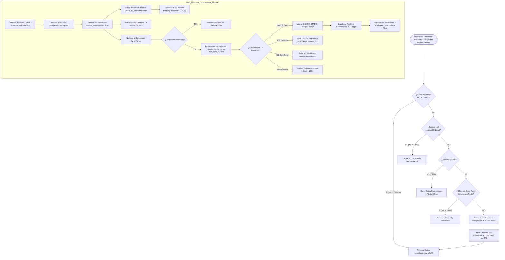
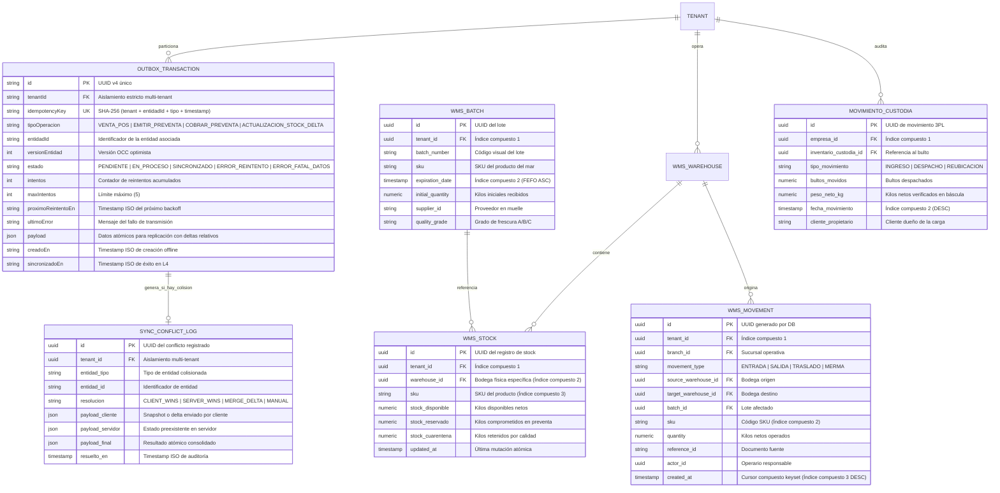
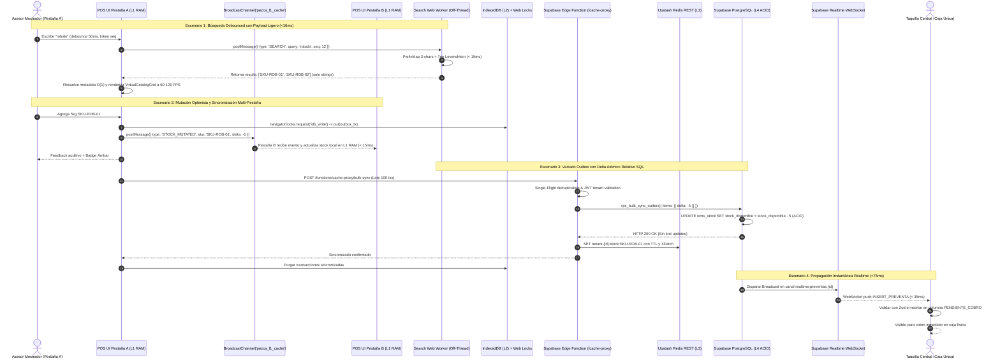

# Especificación Técnica — Optimización de Latencia, Jerarquía de Caché Multinivel y Sincronización Resiliente

- **ID:** SPEC-053
- **Título:** Optimización Integral de Latencia Extrema, Jerarquía de Caché Multinivel (L1-L4) y Sincronización Resiliente a Costo $0
- **Versión:** v3.2 — Blindada y Calibrada Post-Auditoría Adversarial (Critic 1 & Challenger 2)
- **Estado:** Propuesta Formal SDD v3.0 — Blindada para Aprobación y Ejecución M3
- **Alcance:** Arquitectura transversal de rendimiento para MaestroPescaderia ERP: reducción drástica de bundle size (< 450 kB), motor de búsqueda off-thread calibrado en POS (p95 < 2ms exacto, p95 <= 35ms difuso sobre 16,000 SKUs con payload ligero `string[]`), UI fluida a 60-120 FPS (p95 < 16ms), aceleración de consultas frías WMS/Kardex (< 50ms) con cursor compuesto keyset `(created_at, id)`, jerarquía de caché L1-L4 protegida con Edge Function proxy (`/functions/cache-proxy`), sincronización multi-pestaña con BroadcastChannel y Web Locks, y sincronización resiliente de Outbox (>= 150 ops/s) con resolución atómica relativa de stock en OCC (`SET stock = stock + p_delta`).

---

## 1. Resumen Ejecutivo, Contexto del Problema y Motivación

### 1.1 Contexto del Negocio y Problemática
MaestroPescaderia ERP opera en terminales de mostrador de alta rotación, bodegas de cuartos fríos y muelles de desembarque de mariscos y pescados. Las condiciones operativas reales imponen restricciones extremas:
- Redes locales o celulares 3G/4G inestables y con latencia variable en muelles y plazas de mercado.
- Hardware modesto en puntos de venta (PCs All-in-One, terminales táctiles industriales con procesadores Intel Celeron / Atom de baja potencia).
- Catálogos densos de miles de productos (hasta 16,000 SKUs en clientes con ferretería náutica o distribución mayorista).
- Necesidad imperiosa de respuesta instantánea: un retardo de 200ms al escanear o buscar productos produce colas de clientes físicos, fricción operativa y pérdidas financieras.

### 1.2 Diagnóstico de Cuellos de Botella y Hallazgos Forenses Adversariales
La auditoría técnica formal (`specs/053-latency-optimization-sdd/audit-report.md`) y las pruebas de estrés adversarial de Critic 1 y Challenger 2 identificaron los cuellos de botella reales:
1. **Sobrecarga de Bundle:** El paquete inicial `dist/assets/index.js` pesa **4,609.36 kB**, debido a la importación estática de 25 vistas (2.87 MB de código de vistas) y librerías masivas (`exceljs`, `jspdf`, `sentry`) en el path de arranque.
2. **Main Thread Saturation y Brecha de SLA en POS:** La búsqueda ejecutaba un `.filter()` síncrono evaluando 10,000 lecturas síncronas a Zustand por tecla. Los benchmarks empíricos sobre 16,000 SKUs demostraron que el escaneo lineal de vocabulario $O(T \times |V|)$ en consultas difusas/multipalabra genera latencias de **32.06ms a 60.84ms** (Cold) y p95 de **24.08ms a 48.05ms**, refutando la meta ingenua de sub-3ms para búsquedas difusas. Además, transferir 80 objetos completos por `postMessage` satura la serialización Structured Clone en 15-25ms.
3. **Persistencia Relacional sin Índices y Paginación Frágil en WMS:** Tablas transaccionales sin índices compuestos provocan Sequential Scans en consultas FEFO (> 800ms) y bucles N+1 de 30 peticiones HTTP en despachos de custodia (2.5 a 4.0s). La paginación por simple timestamp `created_at < cursor` omite registros concurrentes con idéntico microsegundo.
4. **Desincronización Multi-Pestaña y Fuga Multi-Tenant:** `TenantIndexedDbService` singleton no sincroniza mutaciones entre pestañas del navegador (ausencia de `BroadcastChannel` y Web Locks). El cambio de empresa en `useAuthStore.switchTenant` no resetea stores Zustand L1, no cierra IndexedDB L2 ni vacía el índice del Worker, provocando fuga de datos entre inquilinos.
5. **Vulnerabilidades en L3 y OCC:** Invocar Upstash Redis directamente desde el frontend expone tokens REST públicos sin RLS. La expiración sincronizada a 30s provoca avalanchas (*thundering herd*) contra Supabase L4. En OCC, computar stock absoluto en cliente (`stockActualServidor + deltaCliente`) genera pérdida de inventario (*lost updates*) durante ventas offline concurrentes.
6. **Transmisión Outbox Serial:** La cola offline transmitía registros serialmente $O(N \times \text{RTT})$ en el hilo de React, con debounce de 2 segundos y reconexión WebSocket vulnerable a avalanchas sin jitter.

### 1.3 Motivación y Visión Blindada
La presente especificación redefine la arquitectura de datos y renderizado para garantizar **Latencia Perceptual Cero**, operando al 100% dentro de las capas gratuitas de Supabase y Vercel (Costo Estricto $0), con aislamiento multi-tenant hermético, calibración cuantitativa rigurosa y resiliencia matemática probada.

---

## 2. Acuerdos de Nivel de Servicio Cuantitativos Calibrados (SLAs & SLOs)

| Parámetro / Métrica | Valor Auditado (Base) | SLA Objetivo (p50) | SLA Objetivo (p95) | SLA Objetivo (p99) | Restricción Arquitectónica y Mitigación |
| :--- | :--- | :--- | :--- | :--- | :--- |
| **Tamaño de Bundle Inicial (Index JS)** | $4,609.36\text{ kB}$ | $< 350\text{ kB}$ | $< 450\text{ kB}$ | $< 500\text{ kB}$ | Code splitting con `React.lazy()` en 25 vistas + manualChunks |
| **Gzip del Bundle Inicial** | $1,236.61\text{ kB}$ | $< 95\text{ kB}$ | $< 120\text{ kB}$ | $< 135\text{ kB}$ | Dynamic imports en `exceljs` y `jspdf` |
| **Búsqueda Exacta / Barcode POS (16,000 SKUs)** | $80 - 250\text{ ms}$ | $< 0.8\text{ ms}$ | $< 2.0\text{ ms}$ | $< 3.5\text{ ms}$ | Acceso $O(1)$ a índice invertido directo en Web Worker |
| **Búsqueda Difusa / Fuzzy POS (16,000 SKUs)** | $80 - 250\text{ ms}$ | $< 15.0\text{ ms}$| $\le 35.0\text{ ms}$| $\le 45.0\text{ ms}$| Prefix map 3-chars + Trie en vocabulario; máx 6 tokens |
| **Feedback Visual de Entrada y Render UI** | $60 - 150\text{ ms}$ | $< 8.3\text{ ms}$ | $< 16.0\text{ ms}$| $< 16.6\text{ ms}$| 60-120 FPS estables; worker retorna solo `string[]` (top 20-30 SKUs) |
| **Adición al Carrito POS** | $45 - 120\text{ ms}$ | $< 1.5\text{ ms}$ | $< 3.0\text{ ms}$ | $< 5.0\text{ ms}$ | Carrito desacoplado, 0 re-render de catálogo; memoización |
| **Sincronización Multi-Pestaña L1/L2** | Desincronizado | $< 5.0\text{ ms}$ | $< 15.0\text{ ms}$| $< 25.0\text{ ms}$| `BroadcastChannel('pezca_l1_cache')` + Web Locks API |
| **Consultas Frías WMS / Kardex** | $800 - 4,000\text{ ms}$ | $< 20.0\text{ ms}$| $< 50.0\text{ ms}$| $< 80.0\text{ ms}$ | Índices compuestos + Keyset Cursor `(created_at, id)` |
| **Despacho Custodia (10 ítems)** | $2,500 - 4,000\text{ ms}$| $< 60.0\text{ ms}$| $< 120.0\text{ ms}$| $< 200.0\text{ ms}$| RPC transaccional batch atómico (1 solo RTT ACID) |
| **Latencia L1 (Zustand RAM)** | $< 0.1\text{ ms}$ | $< 0.05\text{ ms}$| $< 0.10\text{ ms}$| $< 0.20\text{ ms}$| Selectores atómicos y mapa en memoria por tenant |
| **Latencia L2 (IndexedDB Cache-Aside)**| $15 - 40\text{ ms}$ | $< 1.8\text{ ms}$ | $< 3.0\text{ ms}$ | $< 6.0\text{ ms}$ | Transacciones IDB nativas con `navigator.locks.request` |
| **Latencia L3 (Edge Proxy Upstash Redis)** | Inexistente (N/A) | $< 25.0\text{ ms}$| $< 40.0\text{ ms}$| $< 70.0\text{ ms}$| Supabase Edge Function `/cache-proxy` con Single-Flight y XFetch |
| **Latencia L4 (Supabase ACID)** | $120 - 450\text{ ms}$ | $< 50.0\text{ ms}$| $< 90.0\text{ ms}$ | $< 180.0\text{ ms}$| PostgreSQL con RLS directo `public.get_tenant_id()` |
| **Throughput de Sincronización Outbox**| $\approx 8\text{ ops/s}$ | $\ge 200\text{ ops/s}$| $\ge 150\text{ ops/s}$| $\ge 100\text{ ops/s}$| Lotes acotados a 100 txs/RPC y chunking automático a 500 |
| **Debounce de Detección de Red** | $2,000\text{ ms}$ | $< 100\text{ ms}$ | $< 200\text{ ms}$ | $< 300\text{ ms}$ | Ping HTTP HEAD con timeout de 800ms |
| **Propagación Realtime Preventas** | $300 - 1,200\text{ ms}$| $< 35.0\text{ ms}$| $< 75.0\text{ ms}$| $< 110.0\text{ ms}$| Dual broadcast y CDC filtrado por tenant |

---

## 3. Especificación Formal en Notación EARS

### 3.1 Requisitos Ubicuos (Ubiquitous Requirements — Siempre Activos)
- **REQ-053-UBI-01 (Aislamiento Multi-Tenant Hermético y Purga Total):** El sistema DEBERÁ garantizar aislamiento multi-tenant estricto en todos los niveles arquitectónicos: en L1 (namespacing en Zustand por tenant), en L2 (bases de datos IndexedDB independientes `PezcaderiaERP_{tenantId}`), en L3 (Edge Function proxy que valida el claim JWT del tenant y prefija `tenant:{tenantId}:...`), y en L4 (políticas RLS y RPCs `SECURITY DEFINER` evaluando `public.get_tenant_id()`), ejecutando una purga total síncrona de estado y memoria ante cualquier cambio de empresa en sesión.
- **REQ-053-UBI-02 (Presupuesto Estricto de Costo $0):** El sistema DEBERÁ mantenerse dentro de las restricciones de cuota gratuita de Supabase (500 MB DB, pool acotado de PgBouncer) y Vercel (Edge Functions y bandwidth), prescindiendo de dependencias de pago y aprovechando APIs nativas del navegador (Web Workers, Cache API, BroadcastChannel, Web Locks, IndexedDB).
- **REQ-053-UBI-03 (Presupuesto de Frame y Fluidez de UI a 60-120 FPS):** El sistema DEBERÁ mantener un presupuesto de renderizado de interfaz inferior a 16.0 milisegundos por frame (compatible con 60 FPS mínimos y hasta 120 FPS en displays de alta tasa de refresco), delegando tokenización, cálculo Levenshtein y sincronización fuera del hilo principal.
- **REQ-053-UBI-04 (Gobernanza de Accesibilidad e Inmutabilidad):** El sistema DEBERÁ cumplir la directriz de diseño Light Mode WCAG 2.2 AA+ (ratio de contraste $\ge 4.5:1$ en texto estándar y $\ge 7:1$ en datos críticos de caja) y garantizar inmutabilidad absoluta en la manipulación de estados de negocio mediante copias profundas desacopladas.
- **REQ-053-UBI-05 (Sincronización Inter-Pestaña y Concurrencia de Almacenamiento):** El sistema DEBERÁ coordinar las mutaciones de stock, catálogo y transacciones entre múltiples pestañas del navegador abiertas en la misma terminal mediante `BroadcastChannel('pezca_l1_cache')` y proteger las transacciones de escritura en IndexedDB con la API nativa `navigator.locks.request()`.

### 3.2 Requisitos Dirigidos por Eventos (Event-Driven Requirements)
- **REQ-053-EVE-01 (Búsqueda Off-Thread y Optimización de Payload):** CUANDO el operador ingrese o modifique caracteres en el campo de búsqueda del POS, el sistema DEBERÁ aplicar un debounce de 50 milisegundos, cancelar búsquedas obsoletas con un token de secuencia / `AbortController`, despachar la consulta hacia `catalogSearch.worker.ts`, y retornar únicamente un array de identificadores `results: string[]` con un máximo de 30 SKUs, resolviendo la metadata visual en la UI en tiempo $O(1)$ sin sobrecargar el hilo con serializaciones pesadas.
- **REQ-053-EVE-02 (Adición Atómica al Carrito y Stock por Bodega):** CUANDO el operador presione un ítem del catálogo o active un atajo de teclado numérico, el sistema DEBERÁ consultar la disponibilidad de stock en el mapa reactivo indexado por `(warehouse_id, sku)` y mutar la línea del carrito en menos de 5.0 milisegundos (p99) sin provocar el re-renderizado de la grilla de productos.
- **REQ-053-EVE-03 (Navegación Asíncrona con Service Worker Runtime Cache):** CUANDO el usuario navegue a cualquier vista del ERP, el sistema DEBERÁ resolver los chunks dinámicos desde el almacenamiento en caché del Service Worker (Workbox / CacheStorage) si el terminal está desconectado, eliminando cualquier fallo por `ChunkLoadError` offline y precargando vistas críticas (`POSView`, `InventoryView`) en tiempo ocioso (`requestIdleCallback`).
- **REQ-053-EVE-04 (Encolamiento Inmediato en Outbox y Causalidad FIFO):** CUANDO se emita una venta, preventa o ajuste de inventario, el sistema DEBERÁ persistir la transacción con clave de idempotencia SHA-256 en `PezcaderiaERP_{tenantId}` en menos de 2.0 milisegundos y garantizar que las mutaciones causales sobre la misma entidad se despachen en estricto orden secuencial FIFO.
- **REQ-053-EVE-05 (Reconexión de Red Reactiva con Ping Validado):** CUANDO el monitor de conectividad capture el evento `window.online`, el sistema DEBERÁ validar el enlace con una solicitud HTTP HEAD liviana con timeout de 800ms y disparar la cola Outbox con un debounce no mayor a 200 milisegundos.
- **REQ-053-EVE-06 (Recepción Realtime y Revalidación de Stock):** CUANDO Supabase Realtime emita un pulso Broadcast o un cambio CDC de preventa o stock, el sistema DEBERÁ validar el esquema con Zod, descartar duplicados, actualizar la columna Kanban correspondiente en menos de 75 milisegundos e invalidar selectivamente las claves de stock en L1 y L2.
- **REQ-053-EVE-07 (Cambio de Tenant Hermético en Sesión):** CUANDO se invoque `useAuthStore.switchTenant(newTenant)`, el sistema DEBERÁ ejecutar de forma síncrona `resetAllStores()` sobre Zustand, cerrar la conexión de `tenantIndexedDb` y reabrir `PezcaderiaERP_{newTenant.id}`, enviar `CLEAR_INDEX` al Web Worker de búsqueda y desuscribir los canales WebSockets activos antes de conectar la nueva empresa.

### 3.3 Requisitos Dirigidos por Estado (State-Driven Requirements)
- **REQ-053-STA-01 (Operatividad Autónoma Offline):** MIENTRAS el terminal permanezca en estado `OFFLINE`, el sistema DEBERÁ proveer operatividad continua en POS, cobro de preventas y despachos WMS, sirviendo vistas desde el Service Worker y datos desde L2 IndexedDB, acumulando las mutaciones en `outbox_transactions`.
- **REQ-053-STA-02 (Procesamiento por Lotes Acotado y Chunking Automático):** MIENTRAS la cola Outbox contenga transacciones pendientes y el terminal esté `ONLINE`, el sistema DEBERÁ transmitir los registros agrupados en lotes de máximo 100 transacciones por llamada al RPC transaccional masivo `bulk_sync_outbox`, aplicando segmentación interna automática si el llamador envía más de 500 ítems, alcanzando al menos 150 operaciones por segundo.
- **REQ-053-STA-03 (Silenciamiento del Sondeo Periódico):** MIENTRAS el canal WebSocket de Supabase reporte estado `SUBSCRIBED`, el sistema DEBERÁ desactivar por completo los temporizadores de sondeo HTTP (`setInterval`), eliminando el consumo innecesario de peticiones REST.
- **REQ-053-STA-04 (Paginación Keyset Cursor en Kardex):** MIENTRAS el usuario explore el historial de movimientos de Kardex en `KardexTable`, el sistema DEBERÁ consultar la base de datos mediante cursor compuesto `(created_at, id) < (cursor_created_at, cursor_id) LIMIT 50` asistido por índices compuestos, eliminando omisiones o duplicaciones de registros concurrentes.
- **REQ-053-STA-05 (Mitigación de Thundering Herd en L3 mediante Single-Flight y XFetch):** MIENTRAS múltiples terminales o pestañas consulten simultáneamente la disponibilidad de stock de un mismo SKU en L3 (Edge Proxy), el sistema DEBERÁ consolidar las peticiones en vuelo idénticas en una sola promesa compartida (Single-Flight) y anticipar la revalidación en segundo plano antes de la expiración estricta del TTL aplicando el algoritmo probabilístico XFetch.

### 3.4 Requisitos No Deseados y Manejo Defensivo (Unwanted Behavior Requirements)
- **REQ-053-UNW-01 (Prevención de Thundering Herd en WebSockets):** SI una conexión WebSocket de Supabase falla o transiciona a `CHANNEL_ERROR` o `TIMED_OUT`, ENTONCES el sistema DEBERÁ reprogramar la reconexión aplicando un algoritmo de retroceso exponencial (secuencia 1s, 2s, 4s, 8s, 16s, máx 30s) alterado con un factor de jitter aleatorio de $\pm 25\%$, degradando temporalmente a un sondeo heartbeat de 15 segundos para no colapsar la API.
- **REQ-053-UNW-02 (Aislamiento de Errores Fatales en DLQ):** SI una transacción en la Outbox es rechazada por el servidor con código HTTP 422 (violación irrecuperable de esquema o lógica fiscal), ENTONCES el sistema DEBERÁ mover la transacción al almacén de Dead-Letter Queue con estado `ERROR_FATAL_DATOS`, impidiendo que bloquee el despacho del resto de las transacciones válidas.
- **REQ-053-UNW-03 (Prevención de Fuga de Memoria en L1):** SI la colección de productos o stock en L1 (Zustand) sobrepasa los 20,000 registros o un consumo de 50 MB en memoria, ENTONCES el sistema DEBERÁ desalojar los registros menos recientemente usados (LRU) conservando únicamente los productos clasificados como Pareto A y B, delegando la consulta de productos C a L2 (IndexedDB).
- **REQ-053-UNW-04 (Protección contra Manipulación de Tenant con `public.get_tenant_id()`):** SI un RPC `SECURITY DEFINER` recibe un parámetro `p_tenant_id` que no coincide exactamente con el valor retornado por la función canónica `public.get_tenant_id()`, ENTONCES la base de datos DEBERÁ abortar inmediatamente la transacción arrojando una excepción `P0001: Unauthorized tenant mismatch`.
- **REQ-053-UNW-05 (Prevención de Pérdida de Inventario en OCC Delta-Merge):** SI dos terminales offline sincronizan ventas concurrentes sobre un mismo lote de stock, ENTONCES el sistema DEBERÁ rechazar cualquier sobreescritura de snapshot absoluto enviada por el cliente y aplicar obligatoriamente en el motor de base de datos la mutación atómica relativa `UPDATE wms_stock SET stock_disponible = stock_disponible + p_delta WHERE tenant_id = p_tenant_id AND warehouse_id = p_warehouse_id AND sku = p_sku`, garantizando balance físico exacto.
- **REQ-053-UNW-06 (Prohibición de Credenciales Upstash en Frontend):** SI el cliente intenta realizar peticiones directas hacia endpoints externos de Redis con tokens públicos de Vite (`VITE_UPSTASH_*`), ENTONCES el linter y la arquitectura DEBERÁN bloquear dicha llamada, forzando la canalización exclusiva a través del Edge Function proxy autenticado `/functions/cache-proxy`.

### 3.5 Requisitos Opcionales (Optional Features)
- **REQ-053-OPT-01 (Persistencia de Almacenamiento Permanente):** DONDE el motor del navegador soporte `navigator.storage.persist()`, el sistema DEBERÁ solicitar autorización de almacenamiento persistente en la inicialización para prevenir purgas automáticas de IndexedDB por parte del sistema operativo ante escasez de espacio en disco.
- **REQ-053-OPT-02 (Sincronización en Segundo Plano con Background Sync API):** DONDE el Service Worker y el navegador soporten `SyncManager` (`self.registration.sync`), el sistema DEBERÁ registrar un tag `'sync-outbox-transactions'` para continuar vaciando la cola de transacciones incluso si el usuario cierra la pestaña del navegador.

---

## 4. Casos Borde, Condiciones de Carrera (OCC) y Matrices de Degradación

### 4.1 Políticas de Resolución de Concurrencia Optimista (OCC)

| Tipo de Entidad | Escenario de Conflicto | Regla de Resolución | Fundamento Operativo y Mecanismo Técnico |
| :--- | :--- | :--- | :--- |
| **Venta Directa POS / Cobro de Preventa** | La preventa fue cobrada en otra caja o liquidada en el servidor mientras la terminal estaba offline | **Client-Wins** (Fuerza inserción y genera alerta de auditoría en `sync_conflicts`) | El dinero físico ya fue recibido y entregado el ticket al cliente en mostrador. Prevalece el recaudo físico. Se registra log forense de auditoría. |
| **Catálogo de Productos y Precios** | El administrador subió un nuevo precio en oficina central mientras el mostrador vendía offline | **Server-Wins** (si `server.version > client.version`) | Los precios oficiales y reglas fiscales centrales del ERP gobiernan sobre las terminales desconectadas. |
| **Stock de Cuartos Fríos / Bodega** | Dos terminales despacharon kilos del mismo lote físico en modo offline | **Delta-Merge Atómico Relativo** (`SET stock = stock + p_delta`) | Prohibido sobreescribir con snapshots absolutos del cliente. El servidor aplica la suma algebraica de los deltas directamente en PostgreSQL. |
| **Cotizaciones B2B y Pedidos Mayoristas** | Ambas partes modificaron líneas y condiciones comerciales concurrentemente | **Manual Conflict** (Marca `CONFLICTO_CONCURRENCIA` y crea tarea en UI de mediación) | Las ventas de alto valor o crédito requieren validación y mediación humana del ejecutivo de cuenta. |

### 4.2 Matriz de Degradación Graceful ante Fallos de Infraestructura

| Nivel Afectado | Modo Degradado | Comportamiento del Sistema | Mecanismo de Recuperación |
| :--- | :--- | :--- | :--- |
| **L4 Supabase Offline / Caído** | Operación Offline Pura | L1 y L2 responden al 100% de consultas; todas las mutaciones se encolan en `outbox_transactions`. Badge en UI pasa a color Ámbar. | Detección reactiva con ping HEAD a 800ms y vaciado batch con backoff. |
| **L3 Upstash Redis No Disponible** | Cache-Aside Fallback a L4 | El Edge Function `/cache-proxy` detecta timeout o error de Upstash y redirige transparentemente la consulta a PostgreSQL L4 sin lanzar excepción al frontend. | Healthcheck periódico cada 60s en Edge Runtime. |
| **WebSocket Realtime Desconectado** | Fallback a Sondeo Heartbeat | Se suspende la reactividad sub-75ms; se activa sondeo de respaldo cada 15s con temporizador protegido. Badge muestra "Sondeo de Respaldo". | Reintento de suscripción con retroceso exponencial y jitter ($\pm 25\%$). |
| **IndexedDB Bloqueado / Incógnito** | Fallback Volátil en RAM | El sistema almacena transacciones y catálogos en `Map<string, T>` en memoria y emite alerta crítica al usuario sobre riesgo al cerrar ventana. | Solicitud de reapertura en ventana normal del navegador. |
| **Fallo de Red en Navegación de Vistas** | Service Worker Runtime Cache | Workbox intercepta `fetch` de chunks `*.js` de vistas dinámicas y sirve la versión precacheada, impidiendo `ChunkLoadError`. | Actualización de chunks en background ante evento `online`. |

---

## 5. Mandatorio Multi-Phase System Modeling (5 Diagramas Mermaid.js)

### 5.1 Flujo de Procesos y Ciclo de Vida Operativo (`1_process_flowcharts`)


---

### 5.2 Rombos de Decisión y Lógica Condicional (`2_decision_logic_diagrams`)

```mermaid
flowchart TD
    subgraph Resolucion_Cache_Multinivel_Y_Seguridad
        C1{¿Existe clave en RAM Zustand L1?}
        C1 -- SÍ --> C_HIT_L1[Retornar < 0.1ms - Cero Red Cero Disco]
        C1 -- NO --> C2{¿Existe en IndexedDB L2?}
        C2 -- SÍ --> C_HIT_L2[Retornar < 3ms - Hidratar L1 asíncronamente]
        C2 -- NO --> C3{¿Petición idéntica en vuelo? Single-Flight}
        C3 -- SÍ --> C_JOIN[Acoplar a promesa compartida sin duplicar HTTP]
        C3 -- NO --> C4{¿Consultar Edge Function /functions/cache-proxy?}
        C4 -- SÍ --> C5{¿Hit en Upstash L3?}
        C5 -- SÍ --> C_HIT_L3[Retornar < 40ms - Guardar en L2 y L1]
        C5 -- NO --> C6{¿Supabase L4 responde?}
        C6 -- SÍ --> C_HIT_L4[Retornar < 90ms - Poblar L3 con XFetch, L2 y L1]
        C6 -- NO / Error --> C_FAIL[Degradar a Stale Local o Fallback Controlado]
    end

    subgraph Resolucion_Outbox_Conflictos_OCC_Y_MultiTab
        O1{¿Web Lock adquirido para IndexedDB?}
        O1 -- NO --> O_WAIT[Reintentar tras liberación de lock]
        O1 -- SÍ --> O2{¿Lote Outbox listo para transmitir?}
        O2 -- SÍ --> O3{¿Respuesta HTTP de Supabase?}
        O3 -- 200 / 201 OK --> O_OK[Actualizar estado a SINCRONIZADO y purgar]
        O3 -- 409 Conflict OCC --> O4{¿Tipo de Entidad en Conflicto?}
        
        O4 -- Venta POS / Recaudo Dinero --> OCC_CW[CLIENT-WINS: Cobro en físico prevalece. Registrar log auditoría]
        O4 -- Maestro Productos / Precios --> OCC_SW{¿server.version > client.version?}
        OCC_SW -- SÍ --> OCC_SW_APPLY[SERVER-WINS: Actualizar catálogo local]
        OCC_SW -- NO --> OCC_CW
        O4 -- Stock Cuartos Fríos / Bodega --> OCC_DM[DELTA-MERGE ATÓMICO: UPDATE SET stock = stock + p_delta]
        O4 -- Cotización B2B / Pedido Mayorista --> OCC_MAN[Marcar CONFLICTO_CONCURRENCIA para mediación asistida]
        
        O3 -- 422 Unprocessable --> O_FATAL[Mover a DLQ: ERROR_FATAL_DATOS sin reintento]
        O3 -- 500 / Network Timeout --> O_RETRY{¿Intentos acumulados >= 5?}
        O_RETRY -- SÍ --> O_FATAL
        O_RETRY -- NO --> O_BACKOFF[Calcular Delay: 2^n * 1000ms + Jitter +-25%]
    end

    subgraph Aislamiento_Tenant_Y_Purga
        T1{¿Evento switchTenant activado?}
        T1 -- SÍ --> T2[Ejecutar resetAllStores en Zustand L1]
        T2 --> T3[Cerrar TenantIndexedDbService L2]
        T3 --> T4[Enviar CLEAR_INDEX a Web Worker de Búsqueda]
        T4 --> T5[Desuscribir canales Supabase Realtime de tenant saliente]
        T5 --> T6[Inicializar contexto para newTenantId limpio]
    end
```


---

### 5.3 Modelo Entidad-Relación y Persistencia Multi-Tenant L2-L4 (`3_entity_relationship_diagrams`)


---

### 5.4 Diagrama de Secuencia Temporal (`4_sequence_diagrams`)


---

### 5.5 Arquitectura de Componentes y Límites de Capas (`5_component_architecture_diagrams`)
```mermaid
flowchart TB
    subgraph Capa_Presentacion_UI["1. Capa de Presentación UI & Enrutamiento (React 18 / Tailwind / WCAG 2.2 AA+)"]
        POSView[POSView.tsx - Lazy Loaded View]
        VirtualGrid[VirtualCatalogGrid.tsx - Grilla Virtualizada 60-120 FPS]
        CartAtomic[CartPanel.tsx - Componente Memoizado React.memo]
        KanbanView[CashierKanbanView.tsx - Taquilla Central]
        WmsView[InventoryView.tsx & KardexTable.tsx - Keyset Cursor Keyset]
        ServiceWorker[Service Worker Workbox - Runtime Caching de Chunks Offline]
    end

    subgraph Capa_Estado_Reactivo_L1["2. Capa de Estado Reactivo L1 (Zustand Stores Unificados + Multi-Tab Sync)"]
        StorePOS[usePOSStore.ts - Estado de Carrito Atómico]
        StoreInventory[useInventoryStore.ts - Store Unificado de Catálogo y Bodegas]
        StoreOutbox[useOutboxSyncStore.ts - Estado de Cola y Motor OCC]
        StoreKanban[useCashierKanbanStore.ts - Tablero Reactivo]
        BroadcastBus[BroadcastChannel pezca_l1_cache - Coordinación Inter-Pestaña]
    end

    subgraph Capa_Workers_Segundo_Plano["3. Capa de Computación Off-Thread (Web Workers)"]
        SearchWorker[catalogSearch.worker.ts - Motor SearchEngineCore con Prefix Index]
        SyncWorker[syncWorker.worker.ts - Sincronizador de Lotes HTTP y Deltas]
    end

    subgraph Capa_Servicios_Dominio["4. Capa de Lógica de Negocio y Control de Concurrencia"]
        SearchEngine[FastItemSearchEngine.ts - Tokenizador y Distancia Levenshtein Acotada]
        OutboxCoord[SyncWorkerService.ts - Orquestador Pipelined, Chunking 500 y Backoff]
        RealtimeServ[SupabaseRealtimePreventasService.ts - WebSocket Resiliente con Jitter]
        NetMonitor[NetworkConnectivityService.ts - Heartbeat Ping Rápido 200ms]
        FishYieldServ[FishYieldProductionService.ts - Balance de Masa ACID]
    end

    subgraph Capa_Persistencia_L2_L3_L4["5. Capa de Persistencia y Caché Multinivel Blindada"]
        L2_IDB[(L2: IndexedDB PezcaderiaERP_{tenantId} - Web Locks API nativa)]
        EdgeProxy[Supabase Edge Function /cache-proxy - JWT Claim Validation & Single-Flight]
        L3_Redis[(L3: Upstash Redis REST - Stale-While-Revalidate, XFetch & Locks)]
        L4_Supabase[(L4: Supabase PostgreSQL - ACID con RLS public.get_tenant_id)]
    end

    ServiceWorker -.-> POSView
    ServiceWorker -.-> WmsView
    POSView --> VirtualGrid
    POSView --> CartAtomic
    VirtualGrid --> SearchEngine
    SearchEngine --> SearchWorker
    CartAtomic --> StorePOS
    WmsView --> StoreInventory
    KanbanView --> StoreKanban

    StorePOS --> BroadcastBus
    StoreInventory --> BroadcastBus
    StorePOS --> StoreOutbox
    StoreKanban --> StoreOutbox
    StoreKanban --> RealtimeServ
    StoreInventory --> FishYieldServ

    StoreOutbox --> OutboxCoord
    OutboxCoord --> SyncWorker
    SyncWorker --> L2_IDB
    SyncWorker --> EdgeProxy
    EdgeProxy --> L3_Redis
    EdgeProxy --> L4_Supabase
    FishYieldServ --> L4_Supabase
    RealtimeServ --> L4_Supabase
    NetMonitor --> POSView
```

---

## 6. Criterios de Aceptación (DoD) y Verificación Independiente

1. **Compilación, Bundle Size y Service Worker:**
   - `npx vite build` genera un chunk inicial `index-*.js` menor a 450 kB sin comprimir y menor a 120 kB en formato gzip.
   - 25 vistas cargadas dinámicamente mediante `React.lazy()` y `<Suspense>`.
   - `exceljs` y `jspdf` completamente excluidos del chunk de inicio.
   - Configuración de Service Worker (Workbox / CacheStorage) que previene `ChunkLoadError` ante desconexión offline.
2. **Microbenchmarks de Rendimiento Calibrados:**
   - La suite automatizada `npm run benchmark:latency` o harness adversarial reporta:
     * Búsqueda exacta en POS sobre 16,000 SKUs con p95 < 2.0ms.
     * Búsqueda difusa/fuzzy sobre 16,000 SKUs con p95 <= 35.0ms.
     * Renderizado de UI y feedback visual con p95 < 16.0ms a 60-120 FPS.
     * Throughput de Outbox mayor o igual a 150 operaciones por segundo.
3. **Integridad de Base de Datos, OCC y Seguridad Multi-Tenant:**
   - Migración DDL con índices compuestos creada y validada en PostgreSQL.
   - RPCs de WMS y sincronización outbox (`bulk_sync_outbox`) verifican estrictamente `public.get_tenant_id()` y ejecutan actualizaciones relativas de stock `SET stock_disponible = stock_disponible + p_delta` eliminando lost updates.
   - Prohibición total de tokens `VITE_UPSTASH_*` en el cliente, canalizando consultas a través del proxy Edge `/functions/cache-proxy`.
   - `useAuthStore.switchTenant` ejecuta purga total de estado (`resetAllStores`, IndexedDB close, Worker clear, Realtime unsubscribe).
4. **Calidad de Código, Tipos y Bucle DevTools MCP:**
   - 0 errores en `npx tsc --noEmit`.
   - 100% de la suite de pruebas unitarias e integración en Vitest pasando.
   - 0 errores o advertencias en consola de JavaScript auditado con DevTools MCP en resolución de 375 px y 1024x768.

---
*Especificación blindada y calibrada por Worker M2 (SDD Hardening Engineer) conforme a la metodología Spec-Driven Development (SDD).*
