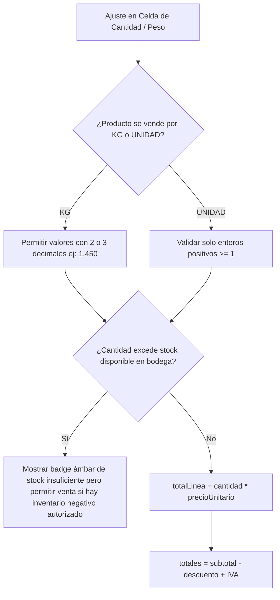
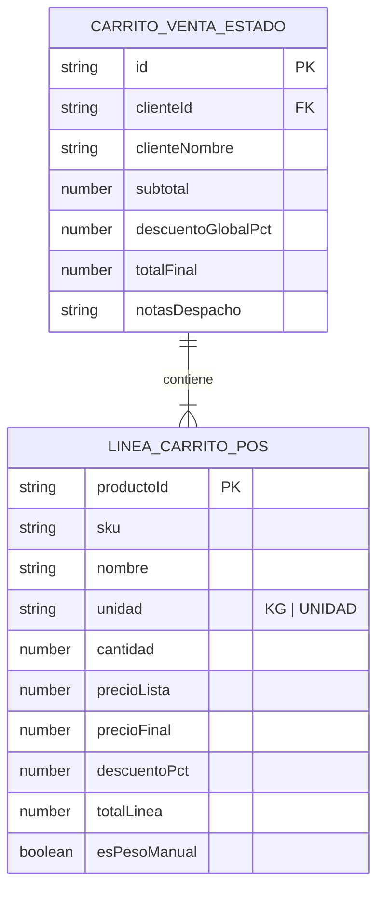
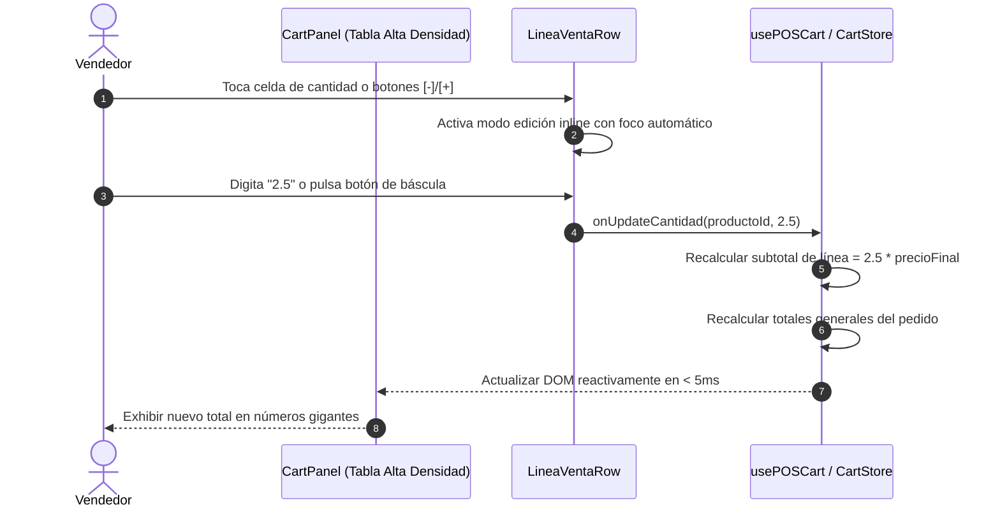
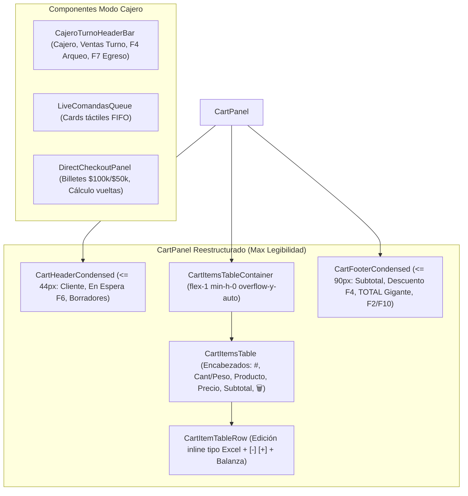

# Especificación Técnica SDD: Modo Cajero Híbrido y Rediseño de Legibilidad del Carrito POS (SPEC-054)
**Dominio:** Ventas & Tesorería · Estación de Vendedor y Taquilla de Cajero (Punto de Venta POS)  
**Metodología:** Spec-Driven Development (SDD v3.0) + Regla del Niño de 12 Años (Fitts ≥ 48px, WCAG 2.2 AA+)

---

## 1. El "Qué" y el "Por Qué"

### 1.1 El Problema (Experiencia de Usuario de Vendedores y Cajeros)
1. **Carrito de Ventas Inutilizable (`CartPanel.tsx`)**:
   - Elementos fijos inflados (Header de 90px, Barra de órdenes parkadas de 95px, Footer de 240px) dejan menos de 50px de altura para la lista de productos en pantallas de 1366x768 / 1280x800.
   - Con 12 o más productos, la lista desaparece o se aplasta visualmente (quedando solo un fragmento "Stock: 50 kg" visible).
   - Botón decorativo macOS (`showMacControls`) con handler `onMinimize` que oculta la lista entera (`hidden`) si se presiona por error.
   - Filas de productos con clases híbridas confusas y hasta 5 badges diminutos que destruyen el contraste y la jerarquía.
2. **Estación del Cajero sin Foco Operativo**:
   - El cajero de taquilla tiene el 65% de la pantalla ocupado por catálogo de productos que no utiliza, mientras que las comandas en espera están ocultas en un drawer secundario.

### 1.2 La Solución (Arquitectura Unificada de Alta Densidad)

#### A. Rediseño Total del Carrito de Ventas (`CartPanel.tsx` & `LineaVentaRow.tsx`):
- **Header Condensado ($\le 44\text{px}$)**: Selector de cliente en chip directo, botón `En Espera (F6)`, acceso a borradores, sin botones decorativos tipo macOS.
- **Tabla Pura de Alta Densidad**:
  - Columnas: `#` | `Cant/Peso` | `Producto (Nombre blanco 14px bold + SKU)` | `Precio` | `Subtotal` | `🗑️ Acciones`.
  - **Edición Híbrida en Celda (Opciones 1 y 2 aprobadas)**:
    - Botones táctiles `[-]` y `[+]` para ajustes rápidos.
    - Input numérico inline tipo hoja de cálculo (un toque activa el campo con foco automático para digitar de inmediato).
    - Botón de captura de peso con báscula serial para productos con unidad `KG`.
  - Altura flexible con `flex-1 min-h-0 overflow-y-auto overscroll-contain` que garantiza visualización clara de 8 a 15 productos simultáneamente.
- **Footer Esbelto Anclado ($\le 90\text{px}$)**:
  - Fila 1: `Subtotal` | `Descuento (F4)` | `IVA`.
  - Fila 2: **TOTAL en números gigantes** | Botón ergonómico principal $\ge 56\text{px}$ (`⚡ PREVENTA F2` para asesores / `⚡ COBRAR F10` para cajeros).

#### B. Modo Cajero Híbrido en POS:
- Interruptor "Modo Cajero" en la cabecera (auto-activado si `userRole === 'cajero'`).
- Reemplazo del catálogo por la **Cola Viva de Comandas FIFO** en el área principal (60%).
- **Panel de Liquidación Directa Permanente** en el panel derecho (40%) con teclado táctil de billetes colombianos ($100k, $50k, $20k, $10k, $5k, $2k) y cálculo en vivo de vueltas.
- Salida post-cobro inmediata: tirilla térmica silenciosa, toast de cambio entregado y auto-selección de la siguiente comanda FIFO.
- Barra superior de turno: Ventas turno en vivo, **Arqueo Ciego (<kbd>F4</kbd>)** y **Egreso Rápido (<kbd>F7</kbd>)**.

---

## 2. Diagramas de Ingeniería Mermaid.js

### Diagrama 1: Flujo de Procesos y Ciclo de Vida (`1_process_flowcharts`)
```mermaid
flowchart TD
    Inicio([Operador ingresa a POS]) --> CheckRol{¿Rol es cajero o activa Modo Cajero?}
    CheckRol -- Sí --> ModoCajero[Modo Cajero: Cola Viva de Comandas + Liquidación Directa]
    CheckRol -- No --> ModoVendedor[Modo Vendedor: Catálogo de Productos + Carrito Tabla Alta Densidad]
    
    subgraph CarritoVendedor ["Flujo de Carrito de Ventas Reconstruido"]
        AgregarProd[Agregar producto de catálogo o SKU] --> RenderTabla[Renderizar fila en Tabla de Alta Densidad]
        RenderTabla --> AjusteCant{Ajuste de Cantidad/Peso}
        AjusteCant -- Tocar celda --> FocoInput[Foco inmediato para digitar cantidad/peso]
        AjusteCant -- Clic botones --> DeltaCant[Incrementar / decrementar con [-] y [+]]
        AjusteCant -- Pesar báscula --> CapturaBascula[Tomar peso serial automáticamente]
        FocoInput --> ActualizarSubtotales[Recalcular Subtotal y Total en tiempo real]
        DeltaCant --> ActualizarSubtotales
        CapturaBascula --> ActualizarSubtotales
        ActualizarSubtotales --> EmitirPreventa[Emitir Preventa PRE-YYYY-XXXXX F2]
    end

    subgraph TaquillaCaja ["Flujo de Taquilla Cajero"]
        ModoCajero --> CargarComanda[Seleccionar comanda de Cola Viva FIFO]
        CargarComanda --> LiquidacionDirecta[Panel Derecho: Total gigante + Medios de pago]
        LiquidacionDirecta --> RecibirBilletes[Pulsar billetes: 100k, 50k, 20k, exacto]
        RecibirBilletes --> CalculoVueltas[Cálculo automático de vueltas en pantalla]
        CalculoVueltas --> ConfirmarLiquidacion[Confirmar cobro Enter / F10]
        ConfirmarLiquidacion --> TirillaTermica[Impresión silenciosa de tirilla]
        TirillaTermica --> SiguienteComanda[Auto-seleccionar siguiente comanda en fila]
    end

    ModoVendedor --> CarritoVendedor
```

---

### Diagrama 2: Lógica de Decisión y Validaciones (`2_decision_logic_diagrams`)


---

### Diagrama 3: Modelo Entidad-Relación (`3_entity_relationship_diagrams`)


---

### Diagrama 4: Diagrama de Secuencia de la Edición Inline (`4_sequence_diagrams`)


---

### Diagrama 5: Arquitectura de Componentes de Presentación (`5_component_architecture_diagrams`)

