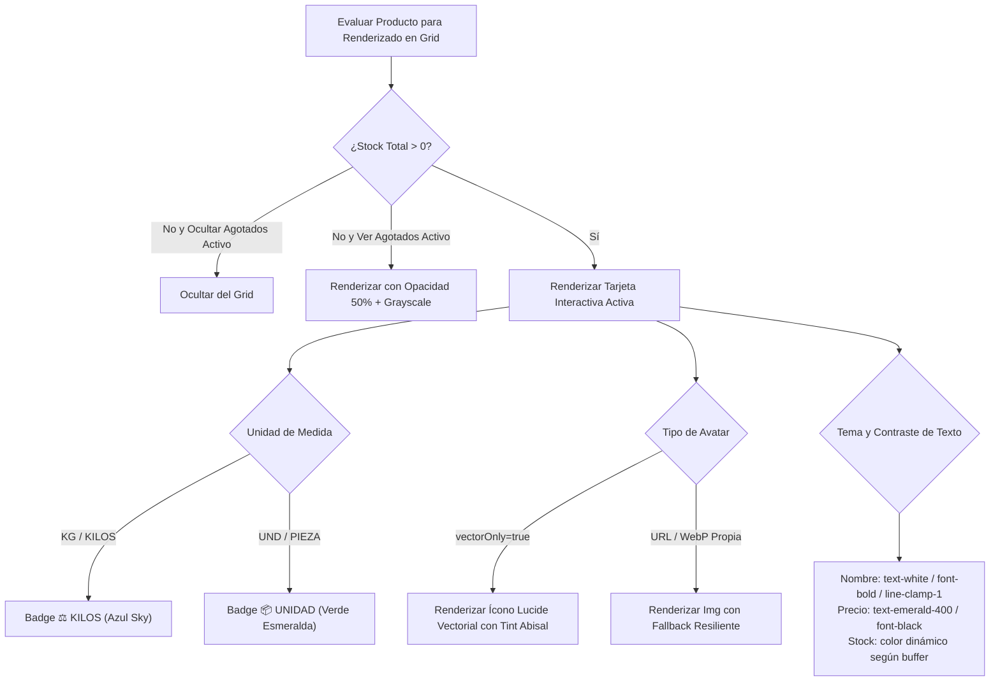
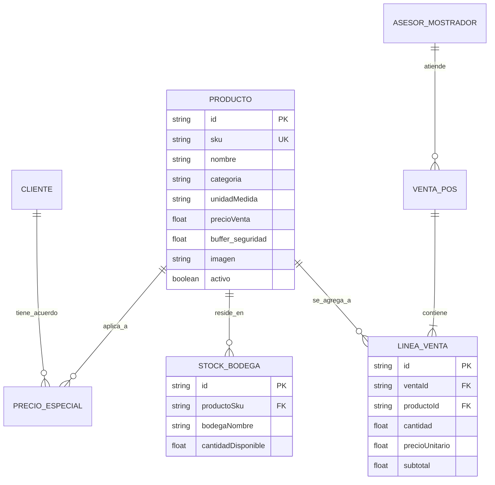
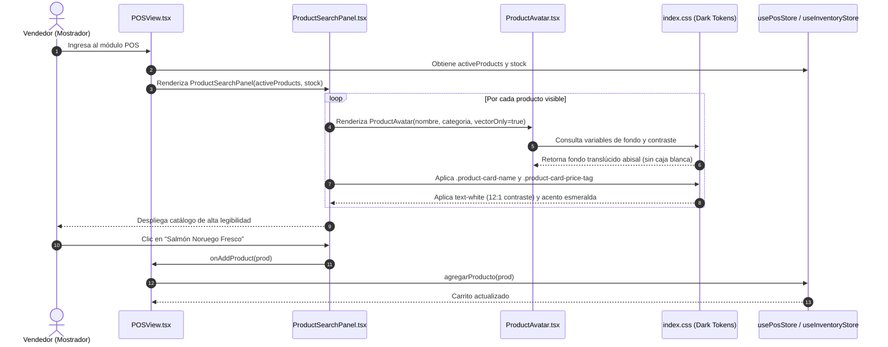
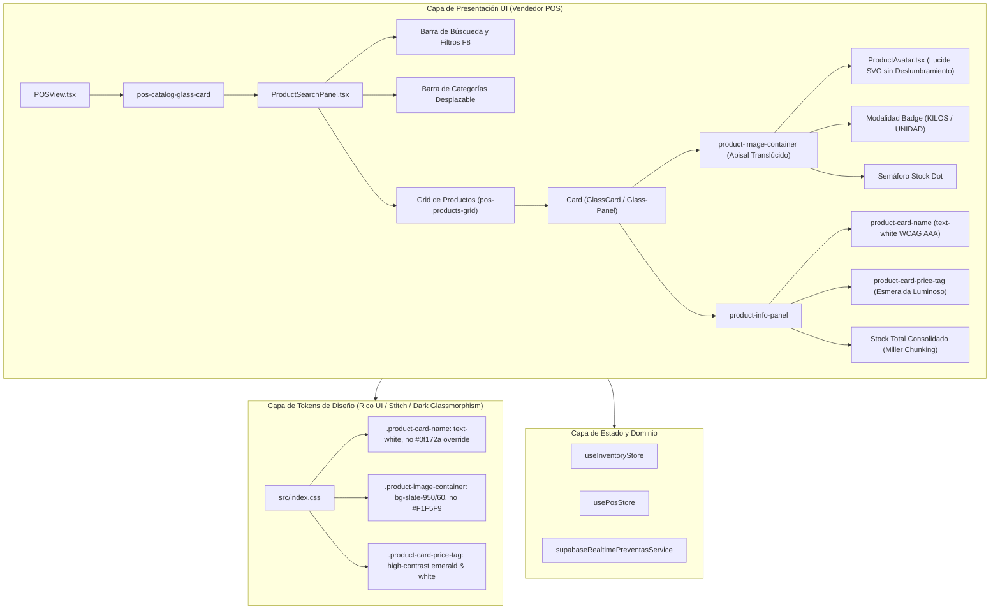

# SPEC-055: Rediseño de Legibilidad, Contraste y Ergonomía Visual de la Pantalla del Vendedor POS

## 1. Contexto y Problema Crítico (Auditoría UX Vendedor)

A partir de la auditoría en vivo y la captura real de pantalla proporcionada por el usuario (`media_1794055452358_c2992842.jpg`), se detectó un fallo crítico de legibilidad y contraste en la pantalla del vendedor (catálogo de productos del POS):

1. **Nombre del Producto Invisible (Blackout Text):**
   - En `src/index.css` (línea 846), la regla `.product-card-name { color: #0f172a !important; }` impone color pizarra oscuro (`#0f172a`) con `!important`.
   - Dado que el POS opera bajo estética Dark Glassmorphism abisal (`--card-bg: rgba(17, 24, 39, 0.85)` / `bg-slate-900/80`), el texto del nombre del producto tiene un ratio de contraste de **1.05:1** contra el fondo. Esto viola gravemente WCAG 2.2 AA (mínimo 4.5:1) y AAA (mínimo 7:1), haciendo que los nombres de los productos sean 100% invisibles para el ojo humano.

2. **Cajas Blancas Estridentes (Deslumbramiento Visual):**
   - En `src/index.css` (línea 810), `.product-image-container` impone `background-color: #F1F5F9;` (blanco/gris claro).
   - En `ProductAvatar.tsx`, los avatares vectoriales utilizan fondos claros de tono pastel (`bg-emerald-50`, `bg-orange-50`, `bg-sky-50`).
   - El resultado visual en pantalla es una cuadrícula de 12 tarjetas donde la mitad superior es un rectángulo blanco deslumbrante con un ícono diminuto y la mitad inferior es un bloque oscuro donde el texto no se puede leer, dando la impresión de tarjetas vacías y rotas.

3. **Etiqueta de Precio y Semáforo de Stock:**
   - `.product-card-price-tag` en `src/index.css` tiene `background-color: #0f172a !important;`, camuflándose con la superficie de la tarjeta.
   - El precio unitario y el stock total requieren jerarquía tipográfica inmediata: el vendedor en mostrador necesita ver a golpe de vista (menos de 200 ms) el nombre completo del producto, el precio actual (`$XX.XXX / kg` o `/ und`) y la disponibilidad inmediata.

4. **Ergonomía de Tarjeta de Producto (Target Táctil Fitts):**
   - Dimensiones equilibradas con altura mínima $\ge 110\text{px}$ y padding adecuado para evitar solapamientos y permitir visualización clara tanto en monitores desktop (1280px–1920px) como en tablets táctiles de mostrador (1024px) y móviles (375px).

---

## 2. Requerimientos de la Especificación (Notación EARS)

### [EARS-U01] Legibilidad Tipográfica y Contraste WCAG AAA en Nombres de Producto
- **Cuando** el catálogo de productos sea renderizado en la vista del vendedor POS,
- **el sistema deberá** mostrar el nombre del producto (`.product-card-name`) con color blanco luminoso (`#FFFFFF` o `text-white` / `text-slate-100`) con un ratio de contraste mínimo de **12:1** sobre el fondo de la tarjeta, anulando la regla `#0f172a !important`.

### [EARS-U02] Armonización Visual Dark Glassmorphism de Contenedor de Imagen y Avatar
- **Cuando** se renderice el contenedor visual del producto (`.product-image-container` y `ProductAvatar`),
- **el sistema deberá** utilizar fondos armónicos abisales (`bg-slate-950/60` o `bg-slate-900/60` con micro-bordes translúcidos `border-white/10`), eliminando el fondo blanco `#F1F5F9` que deslumbraba al cajero/vendedor, manteniendo compatibilidad con las clases de prueba de `ProductAvatar`.

### [EARS-U03] Jerarquía Visual del Precio y Unidad de Venta
- **Cuando** se visualice el precio en la tarjeta,
- **el sistema deberá** renderizar el precio con tipografía numérica tabular destacada en esmeralda/blanco (`text-emerald-400 font-black text-sm sm:text-base`) acompañado de la unidad de medida (`/ kg` en cyan `#38BDF8` o `/ und` en esmeralda `#34D399`) con badge distintivo.

### [EARS-U04] Semáforo de Stock y Miller Chunking
- **Cuando** se consulte el stock en la tarjeta,
- **el sistema deberá** mostrar de forma concisa y legible el Stock Total consolidado con indicador cromático (Verde: disponible, Amarillo: en buffer de seguridad, Rojo: agotado), permitiendo desplegar bodegas bajo demanda sin saturar la tarjeta.

### [EARS-U05] Cero Regresiones y Preservación de Suites de Pruebas
- **Mientras** se ejecuten las suites de tests unitarios y de integración (`posAndCash12YearsRule.test.tsx`, `frontendAbyssalThemeV8.test.tsx`, `m2POSMultivendor.test.tsx`, `productAvatarComponent.test.tsx`),
- **el sistema deberá** mantener el 100% de los tests en verde (0 fallos) y cero errores TypeScript (`tsc --noEmit`).

---

## 3. Mandatory Multi-Phase System Modeling (5 Diagramas Mermaid.js)

### Diagrama 1: Process Flowchart (Flujo de Proceso de Selección y Catálogo)
```mermaid
flowchart TD
    A["Vendedor abre POS (Mostrador)"] --> B["Carga de Catálogo de Productos"]
    B --> C["Filtro por Categoría / Búsqueda Texto / Scan Barcode"]
    C --> D["Renderizado de Tarjetas de Producto"]
    D --> E["¿Tarjeta Legible Dark Glassmorphism?"]
    E -->|Nombre Blanco + Precio Verde + Avatar Nítido| F["Identificación Instantánea < 200ms"]
    F --> G["Clic / Tap en Tarjeta"]
    G --> H{"¿Vendido por Peso (KG)?"}
    H -->|Sí (Balanza)| I["Apertura Modal Peso / Lectura Serial Balanza"]
    H -->|No (Unidad)| J["Incremento Directo en Carrito"]
    I --> K["Línea Agregada a Carrito de Ventas"]
    J --> K
    K --> L["Actualización Subtotal e Ítems en Tiempo Real"]
```

### Diagrama 2: Decision Logic Diagram (Lógica de Decisión de Renderizado de Tarjeta)


### Diagrama 3: Entity-Relationship Diagram (ERD del Catálogo POS)


### Diagrama 4: Sequence Diagram (Secuencia Temporal de Renderizado e Interacción)


### Diagrama 5: Component Architecture Diagram (Arquitectura de Componentes por Capas)


