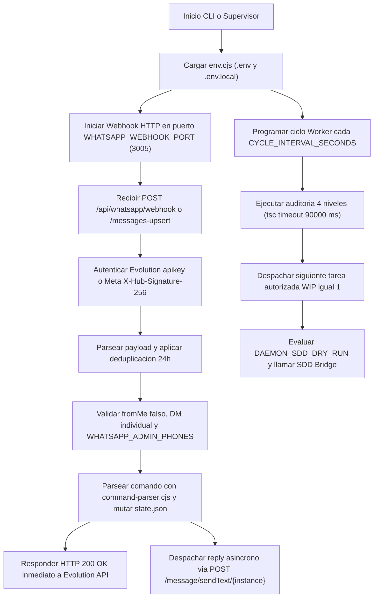
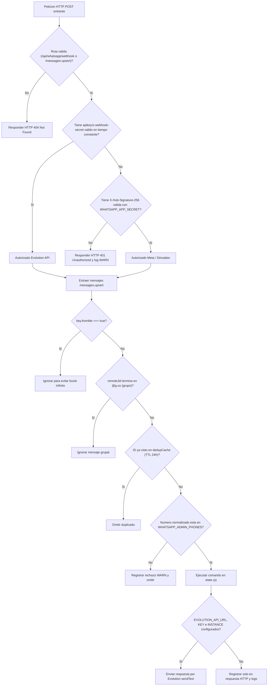
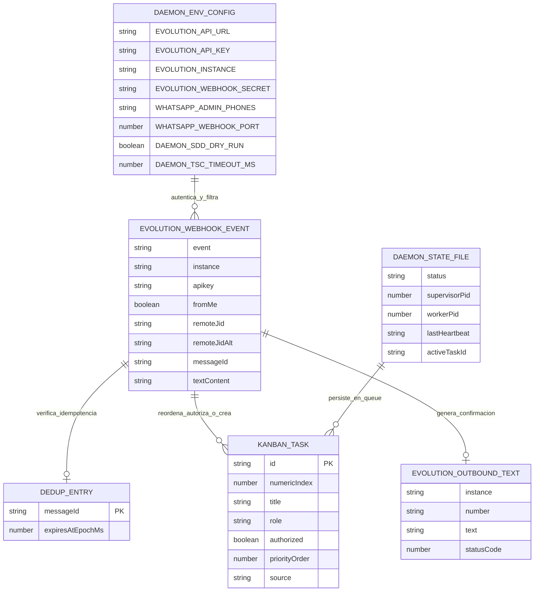
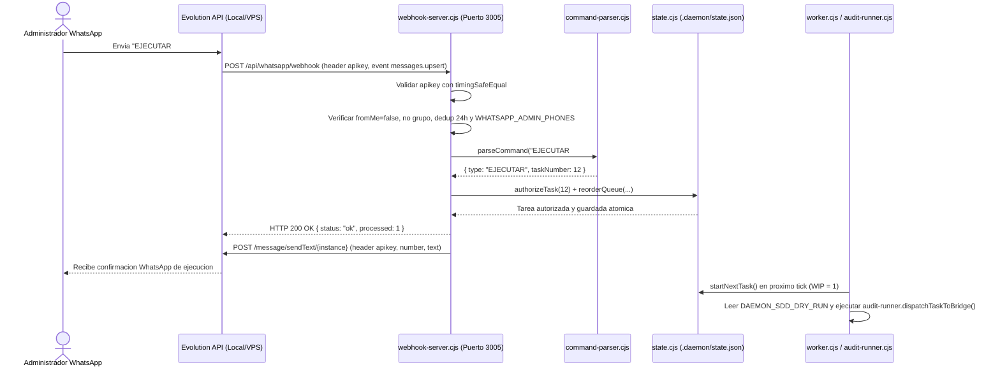
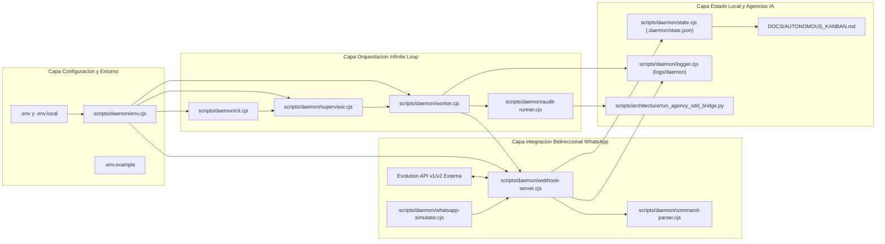

# SPEC-058: Adaptador Bidireccional Evolution API v1/v2 y Robustecimiento del Daemon 24/7

- **Estado:** Borrador para Aprobación Humana (`/speckit.specify` - SDD v3.0)
- **Fecha:** 2026-11-11
- **Módulo:** `scripts/daemon/` (`webhook-server.cjs`, `worker.cjs`, `audit-runner.cjs`, `cli.cjs`, `supervisor.cjs`, `env.cjs`)
- **Referencias Arquitectónicas:**
  - Reporte Swarm + Harness²: `specs/sdd_verification_reports/sdd_bridge_coexecution_20261111_134029.json`
  - Infraestructura existente: `scripts/daemon/*`, `ecosystem.config.cjs`, `tests/daemon/daemon-control-loop.test.ts`, `DOCS/AUTONOMOUS_KANBAN.md`

---

## 1. Contexto, Problema y Alcance ("Qué" y "Por qué")

### 1.1 Motivación de Negocio e Ingeniería
El daemon autónomo 24/7 (`maestro-control-loop`) ya opera bajo el patrón Infinite Control Loop con cola Kanban WIP = 1 (`scripts/daemon/state.cjs`) y auditoría continua de 4 niveles (`scripts/daemon/audit-runner.cjs`). Sin embargo, la capa actual de control remoto vía WhatsApp (`scripts/daemon/webhook-server.cjs`) fue implementada asumiendo exclusivamente la **API directa de Meta Graph**, lo cual impone fricciones operativas (validación estricta de Meta Business, ausencia de envío saliente hacia WhatsApp y falta de carga automática de variables `.env`).

Adicionalmente, el diagnóstico del ciclo `#55` evidenció tres brechas técnicas que impiden pasar el daemon a operación productiva continua con **Evolution API**:
1. **Acoplamiento exclusivo a Meta Graph API:** `webhook-server.cjs` exige firma `X-Hub-Signature-256` en todas las peticiones `POST`, lee constantes de entorno estáticas al momento del `require()` y no parsea eventos `messages.upsert` ni responde vía HTTP hacia Evolution API (`/message/sendText/{instance}`).
2. **Ausencia de cargador `.env` / `.env.local`:** El proyecto no instala `dotenv` en `package.json`, por lo que `scripts/daemon/` ignora variables declaradas en `.env` o `.env.local` si se inicia fuera de un shell pre-exportado.
3. **Timeout insuficiente en `tsc` y ejecución bloqueada en simulación:** `scripts/daemon/audit-runner.cjs` corta `npx tsc --noEmit` a los `30000` ms (generando falsos positivos `TypeScript: FAIL` bajo carga), y `scripts/daemon/worker.cjs` fija `dispatchTaskToBridge(startResult.task, true)` sin bandera configurable por entorno.

### 1.2 Objetivos (In-Scope)
- Cargar `.env` y `.env.local` sin dependencias externas (`scripts/daemon/env.cjs`) respetando variables explícitas del sistema operativo / PM2.
- Adaptar `scripts/daemon/webhook-server.cjs` para recibir webhooks de **Evolution API v1/v2** (`messages.upsert` / `MESSAGES_UPSERT`) en `/api/whatsapp/webhook` y `/api/whatsapp/webhook/messages-upsert`, manteniendo compatibilidad regresiva con firmas HMAC-SHA256 de Meta y `scripts/daemon/whatsapp-simulator.cjs`.
- Implementar validación segura en tiempo constante (`crypto.timingSafeEqual`) mediante `apikey` / `x-webhook-secret` / `Authorization: Bearer` y protección anti-bucle ignorando mensajes propios (`fromMe === true`) o de grupos (`@g.us`).
- Enviar respuestas automáticas por WhatsApp mediante `POST {EVOLUTION_API_URL}/message/sendText/{EVOLUTION_INSTANCE}` de forma asíncrona y tolerante a fallos sin bloquear el ACK `200` del webhook.
- Hacer configurable el timeout de `npx tsc --noEmit` (por defecto `90000` ms via `DAEMON_TSC_TIMEOUT_MS`) y el modo `--dry-run` del puente SDD (`DAEMON_SDD_DRY_RUN`).
- Mantener el daemon apagado (`STOPPED`) hasta completar pruebas unitarias/integración y recibir las credenciales reales del usuario en `.env` / `.env.local`.

### 1.3 Fuera de Alcance (Out-of-Scope)
- No desplegar ni instalar servidores Docker nuevos de Evolution API (el usuario conectará su instancia Evolution existente local o VPS).
- No persistir conversaciones en tablas Supabase (`whatsapp_messages`); el estado sigue siendo 100% local en Node.js CommonJS (`.daemon/state.json` + logs JSONL) a costo `$0`.
- No ejecutar `npm run daemon:start` antes de configurar credenciales reales verificadas.

---

## 2. Requisitos Funcionales y de Calidad (Notación EARS)

| ID | Tipo EARS | Especificación Verificable |
| :--- | :--- | :--- |
| **REQ-01** | Ubiquitous | El módulo `scripts/daemon/env.cjs` **debe** cargar pares clave-valor desde `.env` y `.env.local` sin dependencias npm externas antes de que `cli.cjs`, `supervisor.cjs`, `worker.cjs` y `webhook-server.cjs` lean `process.env`, permitiendo que `.env.local` sobrescriba `.env` sin sobrescribir variables ya definidas explícitamente en el entorno del proceso padre. |
| **REQ-02** | Event-Driven | **Cuando** Evolution API envíe una petición `POST` a `/api/whatsapp/webhook` o `/api/whatsapp/webhook/messages-upsert`, `webhook-server.cjs` **debe** autenticar el secreto compartido (`EVOLUTION_WEBHOOK_SECRET` o `EVOLUTION_API_KEY`) en tiempo constante vía cabeceras `apikey`, `x-webhook-secret`, `authorization` o propiedad `payload.apikey`, rechazando con `401` cualquier petición sin credencial válida (salvo cuando incluya una firma Meta `X-Hub-Signature-256` válida contra `WHATSAPP_APP_SECRET`). |
| **REQ-03** | Unwanted Behavior | **Si** un evento `messages.upsert` contiene `key.fromMe === true` o un remitente de grupo (`remoteJid` terminado en `@g.us`), `webhook-server.cjs` **debe** descartarlo inmediatamente antes de evaluar comandos o emitir respuestas para prevenir bucles infinitos de auto-respuesta y comandos desde chats grupales. |
| **REQ-04** | Event-Driven | **Cuando** llegue un evento `messages.upsert` (o `MESSAGES_UPSERT`) válido en formato objeto o arreglo, `webhook-server.cjs` **debe** extraer el texto desde `message.conversation`, `message.extendedTextMessage.text`, `message.imageMessage.caption` o `message.documentMessage.caption`, normalizar el número desde `key.remoteJidAlt` o `key.remoteJid` (eliminando sufijos `@s.whatsapp.net`, `@c.us`, `@lid` y caracteres no numéricos) y verificar pertenencia a `WHATSAPP_ADMIN_PHONES`. |
| **REQ-05** | State-Driven | **Mientras** `EVOLUTION_API_URL`, `EVOLUTION_API_KEY` y `EVOLUTION_INSTANCE` estén configurados, **cuando** un comando válido (`ESTADO`, `AUDITAR`, `ORDEN`, `EJECUTAR`, `APROBAR`, `RECHAZAR`, `TAREA`, `PAUSAR`, etc.) produzca resultado, `webhook-server.cjs` **debe** despachar la respuesta textual por HTTP/HTTPS (`POST {EVOLUTION_API_URL}/message/sendText/{EVOLUTION_INSTANCE}`) en segundo plano con timeout acotado (`8000` ms) sin bloquear la respuesta `200 OK` al servidor webhook. |
| **REQ-06** | Ubiquitous | `scripts/daemon/audit-runner.cjs` **debe** ejecutar `npx tsc --noEmit` con un timeout configurable mediante `DAEMON_TSC_TIMEOUT_MS` cuyo valor por defecto sea `90000` ms en reemplazo de `30000` ms. |
| **REQ-07** | State-Driven | `scripts/daemon/worker.cjs` **debe** leer dinámicamente `DAEMON_SDD_DRY_RUN` en cada despacho (`startResult.started`): utilizar simulación (`dryRun = true`) por defecto mientras la variable no sea `'false'`, y ejecutar el puente SDD completo (`dryRun = false`) únicamente cuando `DAEMON_SDD_DRY_RUN === 'false'`. |
| **REQ-08** | Conditional | **Si** `cli.cjs start` se invoca sin `EVOLUTION_API_URL`, `EVOLUTION_API_KEY` o `EVOLUTION_INSTANCE` configurados, **debe** emitir una advertencia explícita indicando modo pasivo (solo HTTP local) sin fallar en arranques de diagnóstico, pero el protocolo operativo exige confirmación y credenciales reales en `.env` antes de iniciar `npm run daemon:start` en producción 24/7. |

---

## 3. Modelado del Sistema Multi-Fase (5 Diagramas Mermaid Obligatorios)

### 3.1 Diagrama de Flujo de Procesos (`1_process_flowcharts`)

### 3.2 Diagrama de Lógica de Decisión (`2_decision_logic_diagrams`)

### 3.3 Diagrama Entidad-Relación del Estado Local y Contratos (`3_entity_relationship_diagrams`)

### 3.4 Diagrama de Secuencia Temporal (`4_sequence_diagrams`)

### 3.5 Diagrama de Arquitectura de Componentes por Capas (`5_component_architecture_diagrams`)

---

## 4. Criterios de Aceptación y Checkpoint SDD
1. Ningún archivo de producción ha sido modificado durante `/speckit.specify`.
2. La especificación cubre compatibilidad Evolution API v1/v2 + Meta HMAC + carga `.env`/`.env.local` + prevención de auto-bucle (`fromMe`) + `tsc` 90s + `DAEMON_SDD_DRY_RUN`.
3. **Checkpoint humano:** Esperar confirmación del usuario sobre `SPEC-058` para avanzar a `/speckit.clarify` / `/speckit.plan` / `/speckit.tasks` / `/speckit.implement`.

