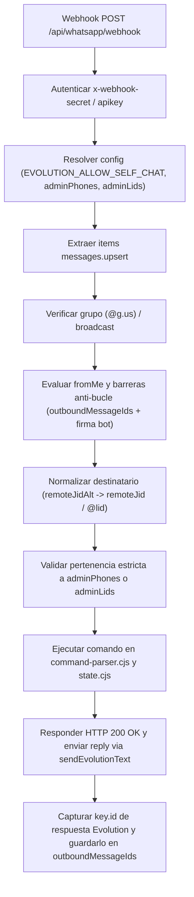
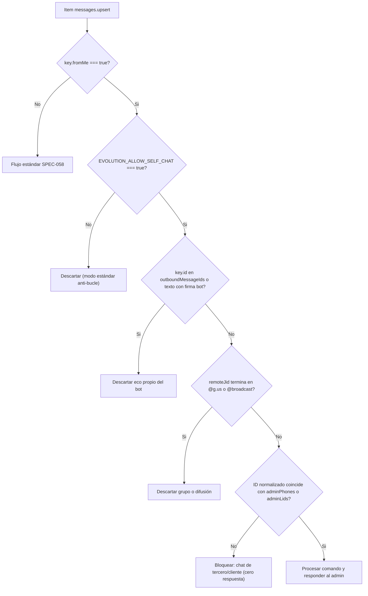
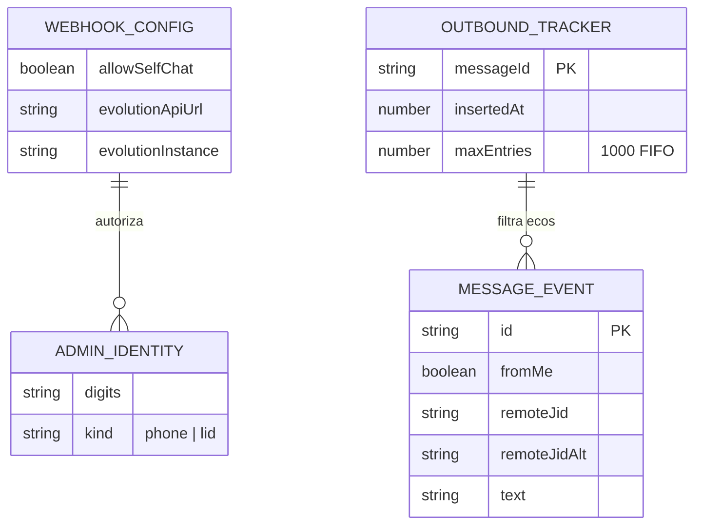
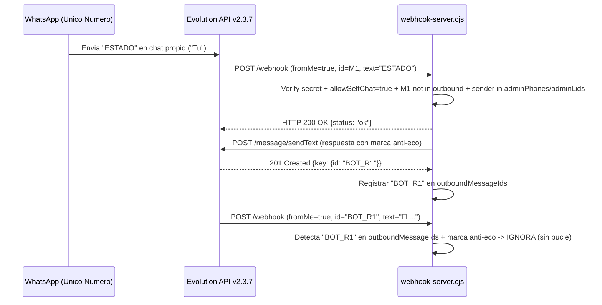
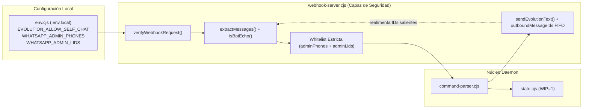

# SPEC-059: Modo Self-Chat Seguro (`EVOLUTION_ALLOW_SELF_CHAT`) para Operación con Un Solo Número WhatsApp

- **Estado:** Aprobado por usuario — Implementación TDD (`SPEC-059`)
- **Fecha:** 2026-11-12
- **Módulo Impactado:** `scripts/daemon/webhook-server.cjs`, `scripts/daemon/cli.cjs`, `.env.example`, `tests/daemon/daemon-control-loop.test.ts`
- **Referencia Swarm + Harness²:** `specs/sdd_verification_reports/sdd_bridge_coexecution_20261112_083407.json`
- **Análisis de Impacto GitNexus:** `npx gitnexus impact extractMessages -r maestro_ERP_Pezcaderia` -> Riesgo **`CRITICAL`** (`457` referencias aguas arriba en el grafo; requiere aislamiento estricto por bandera opt-in y suite regresiva 100% verde).

---

## 1. Contexto, Problema y Alcance ("Qué" y "Por qué")

### 1.1 Problema Técnico Observado
En [SPEC-058](file:///c:/Users/usuario/OneDrive/Documentos/Aplicaciones%20Pezca/MaestroPescaderia/specs/058-daemon-evolution-api/spec.md), `REQ-03` descarta incondicionalmente todo evento `messages.upsert` con `key.fromMe === true` para prevenir bucles infinitos. Sin embargo, cuando el administrador vincula su **único número WhatsApp** tanto como instancia Evolution (`maestro_pescaderia`) como destinatario en `WHATSAPP_ADMIN_PHONES`, los mensajes enviados desde su propio chat ("Tú" / Mensajes guardados) llegan con `key.fromMe === true` y, en Evolution API v2.3.7, pueden llegar con `remoteJid` en formato `@s.whatsapp.net` o `@lid` (ej. `126972134981693@lid` observado en logs del contenedor).

### 1.2 Riesgos Críticos a Mitigar
1. **Bucle infinito de auto-respuesta:** Cuando `sendEvolutionText` envía la respuesta del bot al mismo número, Evolution API re-emite `messages.upsert` con `fromMe: true`. Si se procesara esa respuesta como comando (por ejemplo `🤖 *MaestroPescadería...*` -> `HELP`), el bot respondería indefinidamente.
2. **Fuga hacia chats de clientes/terceros:** Si el usuario conversa desde ese mismo WhatsApp con un cliente y escribe palabras como `"ok"`, `"no"`, `"si"` o `"estado"`, el evento también llega con `fromMe: true`. **Nunca** deben ejecutarse comandos ni enviarse respuestas del ERP hacia chats de terceros.

### 1.3 Objetivos (In-Scope)
- Mantener **desactivado por defecto** (`EVOLUTION_ALLOW_SELF_CHAT=false`) el procesamiento de `fromMe: true` para no alterar entornos multi-número.
- Cuando `EVOLUTION_ALLOW_SELF_CHAT === 'true'`, habilitar procesamiento **exclusivamente** para mensajes `fromMe: true` cuyo destino resuelto coincida con la lista blanca `WHATSAPP_ADMIN_PHONES` (y/o `WHATSAPP_ADMIN_LIDS` si WhatsApp usa `@lid` sin `remoteJidAlt`), rechazando chats grupales (`@g.us`), difusión (`@broadcast`) y cualquier chat con terceros.
- Aplicar **triple barrera anti-bucle**:
  1. Registro en memoria (`outboundMessageIds`, acotado FIFO máx. 1000 entradas) de cada `key.id` devuelto por Evolution API al ejecutar `sendEvolutionText`.
  2. Caché de deduplicación `dedupCache` (24h).
  3. Detección de marcador/firma de respuesta automática emitida por el bot (evita auto-eco incluso si un webhook llega antes de resolverse la respuesta HTTP de `sendText`).
- Documentar `EVOLUTION_ALLOW_SELF_CHAT` (y `WHATSAPP_ADMIN_LIDS` opcional) en `.env.example` sin exponer secretos.

### 1.4 Fuera de Alcance (Out-of-Scope)
- No permitir `fromMe: true` hacia chats de clientes ni grupos bajo ninguna circunstancia.
- No almacenar historiales de chat en Supabase.

---

## 2. Requisitos Funcionales y de Seguridad (Notación EARS)

| ID | Tipo EARS | Especificación Verificable |
| :--- | :--- | :--- |
| **REQ-09.1** | Ubiquitous | `resolveWebhookConfig()` **debe** leer `EVOLUTION_ALLOW_SELF_CHAT` (por defecto `false`, activo solo si es `'true'`) y `WHATSAPP_ADMIN_LIDS` (lista opcional de dígitos LID). Mientras `allowSelfChat` sea `false`, todo evento con `key.fromMe === true` **debe** seguir descartándose idénticamente a `SPEC-058 REQ-03`. |
| **REQ-09.2** | State-Driven | **Mientras** `allowSelfChat` esté activo (`true`), `extractMessages(payload, config)` **debe** admitir un ítem con `key.fromMe === true` únicamente si: (a) no es grupo/difusión (`@g.us`, `@broadcast`), (b) su `key.id` no existe en `outboundMessageIds` ni en `dedupCache`, y (c) el texto no corresponde a un mensaje autogenerado por el bot (firma invisible `\u2063` o cabeceras del bot). |
| **REQ-09.3** | Unwanted Behavior | **Si** un evento con `key.fromMe === true` corresponde a un chat cuyo destinatario normalizado (`remoteJidAlt` o `remoteJid`) **no** pertenece a `config.adminPhones` ni a `config.adminLids`, `webhook-server.cjs` **debe** rechazarlo sin ejecutar comandos ni emitir respuestas hacia ese chat (cero fugas a clientes). |
| **REQ-09.4** | Event-Driven | **Cuando** `sendEvolutionText()` reciba una respuesta HTTP `2xx` de Evolution API conteniendo `key.id`, **debe** registrar inmediatamente ese `id` en `outboundMessageIds` (estructura acotada FIFO) y adjuntar marca anti-eco no intrusiva para bloquear cualquier re-ingreso por webhook. |
| **REQ-09.5** | Verification | **Al** completar la implementación, la suite `npx vitest run tests/daemon/daemon-control-loop.test.ts` (incluyendo pruebas unitarias de self-chat autorizado, bloqueo a terceros, anti-eco por `outboundMessageIds` y marcado de bot), `npx tsc --noEmit` y la prueba en vivo hacia Evolution API **deben** aprobar al 100%. |

---

## 3. Modelado del Sistema Multi-Fase (5 Diagramas Mermaid Obligatorios)

### 3.1 Diagrama de Flujo de Procesos (`1_process_flowcharts`)

### 3.2 Diagrama de Lógica de Decisión (`2_decision_logic_diagrams`)

### 3.3 Diagrama Entidad-Relación (`3_entity_relationship_diagrams`)

### 3.4 Diagrama de Secuencia (`4_sequence_diagrams`)

### 3.5 Diagrama de Arquitectura de Componentes (`5_component_architecture_diagrams`)

