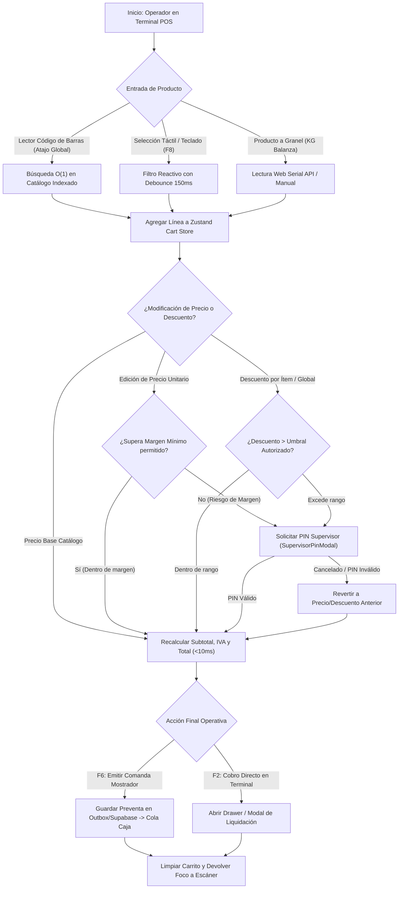
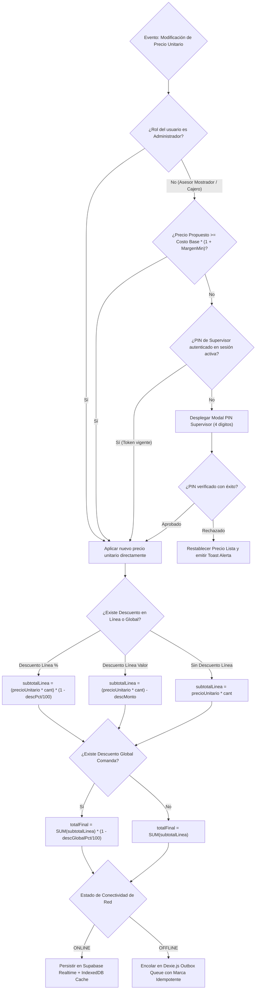
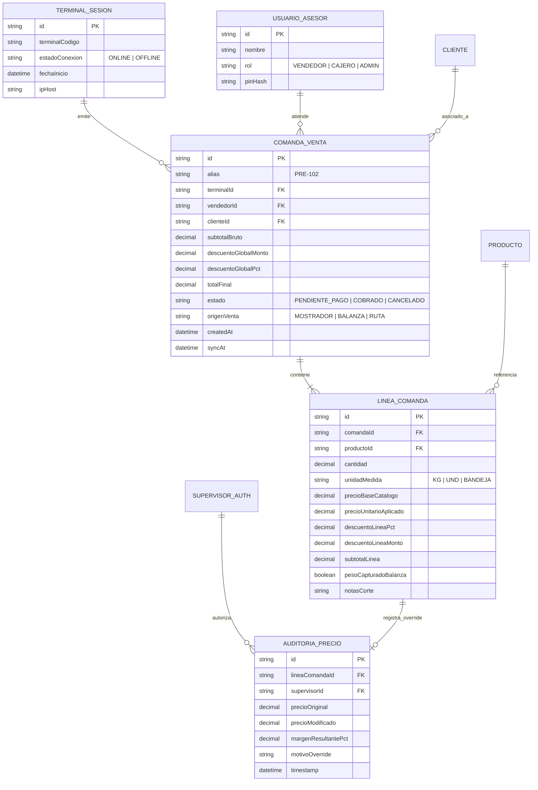
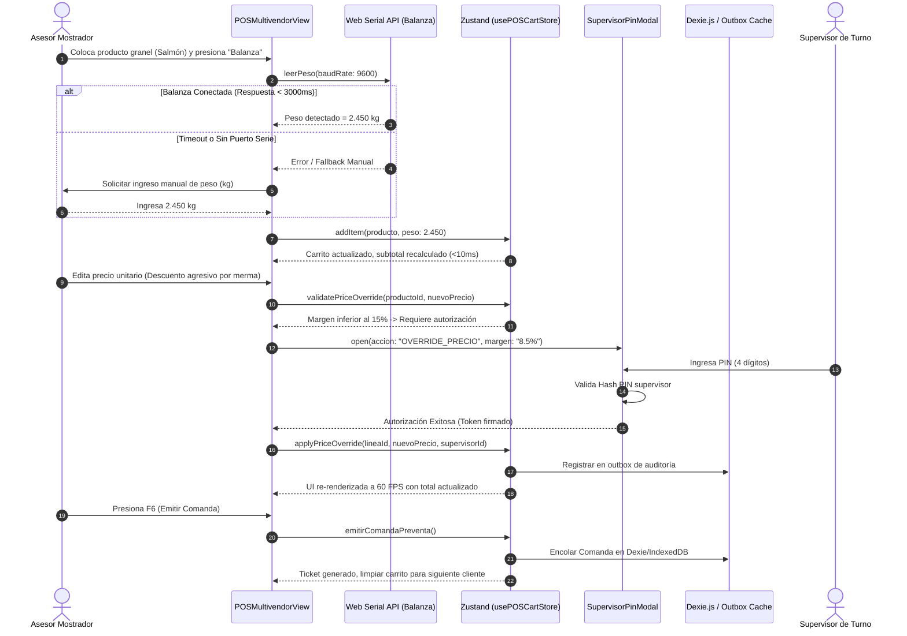
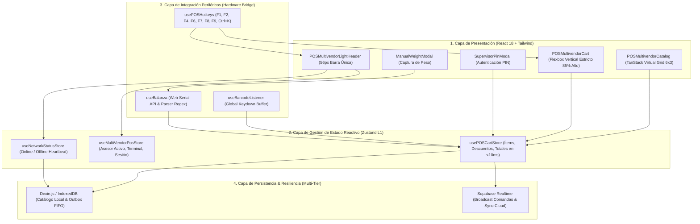

# Plan Integral de Refactorización y Desarrollo Frontend: Interfaz POS — La Pezcadería S.A.S. (SPEC-057)

**Fecha:** 2026-11-08  
**Versión:** 1.0.0 (SDD v3.0 / Spec Kit)  
**Autor:** Antigravity Architect & Agency Swarm (Co-ejecución Harness²)  
**Estado:** PROPUESTO — En espera de interrogatorio /grill-me y aprobación de usuario  

---

## 1. Visión y Objetivos del Documento

Proveer a la fábrica de software y agencias de desarrollo los lineamientos arquitectónicos deterministas, correcciones ergonómicas de interfaz (UI/UX), optimización de hardware periférico y lógicas financieras requeridas para llevar el Punto de Venta (POS) web a un estándar de grado industrial (60 FPS, operaciones sub-50ms, tolerancia a fallos offline y ergonomía táctil Fitts $\ge 48$px).

---

## 2. Modelado de Ingeniería del Sistema (5 Diagramas Mermaid Mandatorios)

### 2.1. Diagrama de Flujo de Procesos (`1_process_flowcharts`)
Ciclo de vida secuencial desde la captura de producto (escáner o balanza) hasta la emisión de comanda o cobro.

---

### 2.2. Diagrama de Lógica de Decisiones (`2_decision_logic_diagrams`)
Rombos de decisión `{...}` para el motor de precios dinámicos, descuentos y contingencia de conectividad.

---

### 2.3. Diagrama Entidad-Relación (`3_entity_relationship_diagrams`)
Estructura relacional de datos para comanda, líneas, descuentos, auditoría de precios y balance de balanza.

---

### 2.4. Diagrama de Secuencia Temporal (`4_sequence_diagrams`)
Flujo de eventos interactivos para la captura automática de balanza y autorización de descuento.

---

### 2.5. Diagrama de Arquitectura de Componentes (`5_component_architecture_diagrams`)
Estructura desacoplada en capas (Presentación, Estado Reactivo, Servicios y Hardware).

---

## 3. Decisiones de Negocio y Arquitectura Acordadas (/grill-me)

Tras el interrogatorio interactivo (/grill-me), se establecieron las siguientes definiciones vinculantes:

1. **Validación Comercial y PIN de Supervisor:**
   - La edición de precio unitario o aplicación de descuentos se realiza sin fricción si está dentro del margen permitido.
   - **Disparo de PIN:** Se exige autenticación con PIN de 4 dígitos (mediante `SupervisorPinModal`) si el **Descuento > 10%** o si el **Precio Propuesto < Costo Base + 15%**.

2. **Pesaje de Productos a Granel (KG Balanza):**
   - Al escanear o seleccionar un producto granel, el sistema despliega inmediatamente el **teclado numérico táctil en pantalla** para digitación manual ultrarrápida del peso en kilogramos, evitando bloqueos por peticiones automáticas de Web Serial API.

3. **Catálogo y Virtualización de Rendimiento:**
   - Se mantiene la paginación ergonómica de **18 tarjetas (6×3)** con la botonera inferior `< Anterior 1 2 3 ... Siguiente >`, virtualizando el conjunto de datos en memoria para garantizar transiciones de filtrado y cambio de categoría por debajo de **16ms (60 FPS)**.

4. **Interacción en Línea del Carrito de Ventas:**
   - Cada fila del carrito presenta **inputs numéricos editables continuos tanto para Cantidad como para Precio Unitario**, permitiendo alternar entre ellos fluidamente mediante la tecla <kbd>Tab</kbd> para velocidad operativa sin mouse.
   - Botón micro `[+ Desc]` en la fila para asignar descuento específico por ítem.

5. **Motor de Descuento Global de Comanda:**
   - Botón anclado **`+ Descuento (F4)`** en el bloque de totales que abre un popover reactivo para alternar entre Porcentaje (%) o Valor Monetario ($), recalculando el Total a Pagar en **menos de 10ms** en el store de Zustand.

---

## 4. Plan de Acción y Desglose por Fases de Desarrollo

### Fase 1: Ergonomía Crítica del Carrito y Control de Textos (UI/UX)
1. **Estructura Flexbox Vertical Estricta:**
   - Contenedor con `h-full min-h-0 flex flex-col`.
   - Área de ítems con `flex-1 min-h-0 overflow-y-auto` que garantiza el 85% del espacio visual útil.
   - Bloque inferior anclado (`shrink-0 mt-auto bg-white border-t border-slate-200`) con Subtotal, Descuentos, Total y Botones de Acción (<kbd>F6</kbd> y <kbd>F2</kbd>).
2. **Text Overflow y Truncamiento Seguro:**
   - Tarjetas de producto y filas del carrito con `line-clamp-2` y `min-w-0` en todos los contenedores flexibles.
   - Tooltips accesibles en hover / long-press para inspección de especificaciones y notas de corte.

### Fase 2: Motor Financiero de Precios Dinámicos y Descuentos Jerárquicos
1. **Edición Dinámica de Precios en Línea:**
   - Input táctil interactivo en la celda de precio unitario del carrito.
   - Detección de desviación de margen ($< 15\%$ sobre costo base).
   - Integración con `SupervisorPinModal` para autorización instantánea con PIN de 4 dígitos.
2. **Descuento por Ítem y Descuento Global:**
   - Selector porcentual (%) o monetario ($) en cada línea del carrito.
   - Botón de descuento global de comanda en el resumen de totales.
   - Recálculo reactivo garantizado en $< 10$ms en Zustand.

### Fase 3: Rendimiento y Virtualización de Catálogo
1. **Integración con TanStack Virtual (`@tanstack/react-virtual`):**
   - Renderizado en viewport de las 18 tarjetas activas de la grilla 6×3 sin saturación del DOM al manejar más de 1,000 SKUs.
2. **Indicadores de Stock y Agotados:**
   - Opacidad reducida (`opacity-60`), badge de advertencia ("AGOTADO") e inhabilitación de clic si el stock es 0 (salvo configuración expresa de preventa en negativo).

### Fase 4: Integración Periférica (Balanza Digital y Atajos de Teclado)
1. **Lector de Código de Barras Global:**
   - Interceptor de buffer de teclado en window para capturar pistolas escáner USB sin requerir foco en el input.
2. **Web Serial API para Balanza Electrónica:**
   - Conexión serial directa (9600 baudios) mediante `useBalanza.ts`. Captura automática de peso en productos tipo `KG`.
3. **Mapeo Estricto de Atajos de Teclado:**
   - <kbd>F8</kbd>: Enfocar buscador de catálogo.
   - <kbd>Ctrl+K</kbd>: Búsqueda rápida multi-criterio.
   - <kbd>F6</kbd>: Emitir Preventa / Comanda de Mostrador.
   - <kbd>F2</kbd>: Cobro Directo en Terminal (Apertura de Drawer).
   - <kbd>F9</kbd>: Alternar a Modo Caja Única (Cola en Vivo).
   - <kbd>Esc</kbd>: Cerrar modales o limpiar selección.

### Fase 5: Persistencia Offline-First y Resiliencia (Dexie.js)
1. **IndexedDB Local Storage:**
   - Caché local de catálogo y clientes para respuesta $< 2$ms.
   - Outbox transaccional FIFO para encolar comandas emitidas sin red y sincronización automática idempotente al recuperar conexión.
