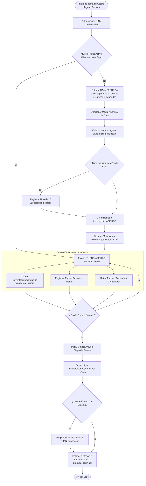
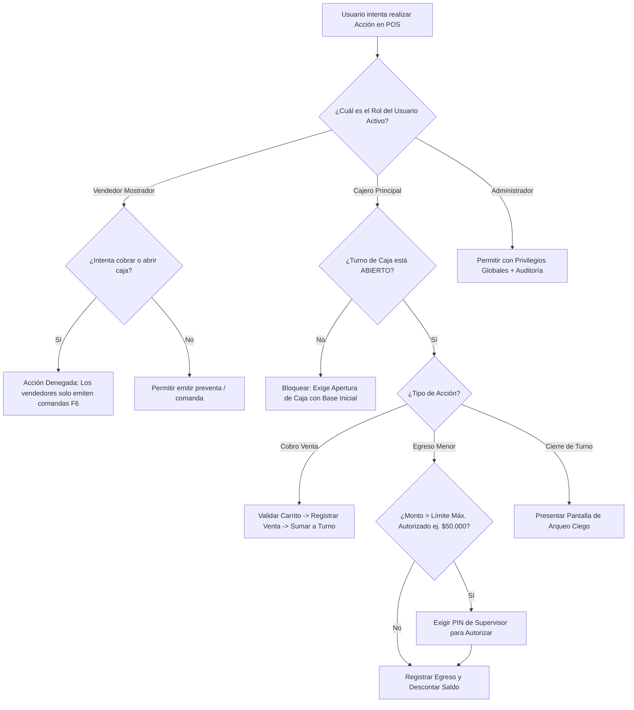
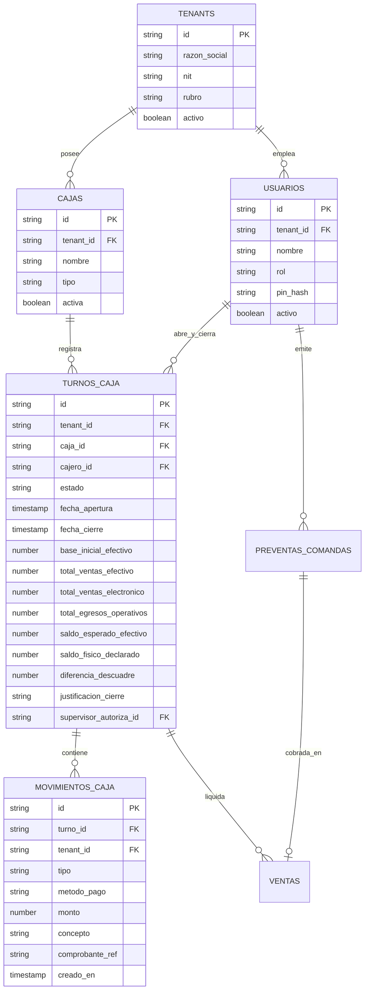
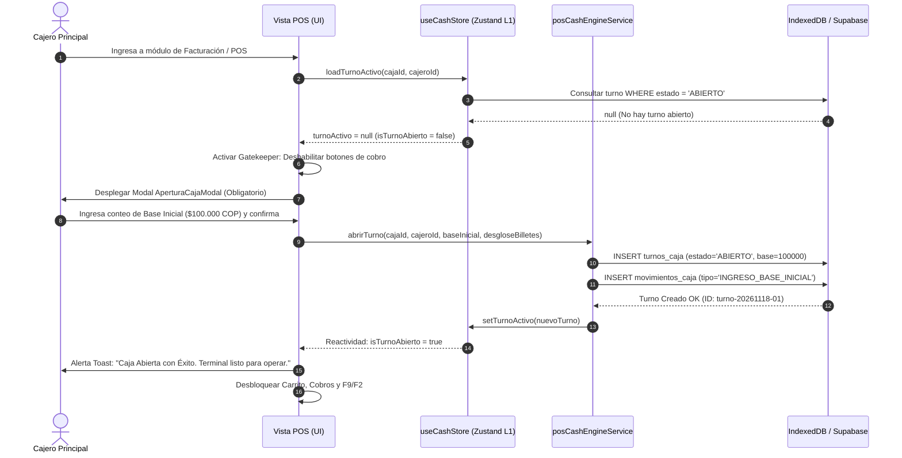
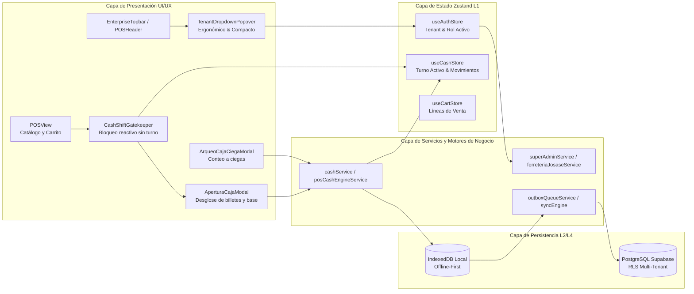

# SPEC-065: Flujo Diario de Cajero Principal, Separación Estricta de Roles y Rediseño Ergonómico de Conmutación Multi-Tenant

**Módulo:** Gestión de Caja, Terminales POS y Conmutación Multi-Tenant  
**Fecha:** 18 de Noviembre de 2026  
**Estado:** PROPUESTA / REVISIÓN SDD (Requiere Aprobación)  
**Autor:** Antigravity Architect & SDD Team  
**Políticas:** Spec-Driven Development (SDD), Lean Kanban (WIP = 1), WCAG 2.2 AA+, Dark Glassmorphism / Light Mode POS  

---

## 1. Resumen Ejecutivo y Diagnóstico

### 1.1. Diagnóstico del Problema Actual
1. **Conmutación Multi-Empresa Invasiva y Poco Clara:**
   - Actualmente, al pulsar el selector de empresa en el encabezado, se abre un modal pesado en pantalla completa (`TenantSelectorModal`) con un fondo oscuro opaco (`bg-slate-950/80 backdrop-blur-md`) que tapa el centro de la pantalla, oscurece la vista de trabajo y obliga al usuario a buscar un botón "Cerrar" en el pie para volver al catálogo.
   - **Solución Propuesta:** Reemplazar el modal bloqueante por un **Popover Dropdown Ergonómico Flotante** anclado al badge del tenant en el Topbar/Header. Con 1 clic conmuta la empresa, re-sincroniza el catálogo en milisegundos y se auto-cierra sin tapar el POS.

2. **Flujo Real Diario de Caja y Apertura Obligatoria:**
   - En una operación comercial real (tanto en ferretería como en pescadería), un cajero no puede registrar pagos, comandas, egresos o sangrías sin antes declarar la **Base Inicial de Efectivo (Apertura de Turno)** en su gaveta.
   - **Solución Propuesta:** Implementar un **Gatekeeper Estricto**:
     - Si el usuario está en rol de Cajero (`CAJERO_PRINCIPAL` o modo cobro central) y la caja está en estado `CERRADA`:
       - Toda acción de cobro o egreso queda bloqueada.
       - Se despliega de forma prioritaria el asistente de **Apertura de Turno** solicitando: Caja física asignada, Saldo sugerido de arrastre (fondo fijo, ej. $100.000 COP) y conteo físico inicial.
       - Al confirmar, el turno pasa a `ABIERTO` y se habilitan los cobros y egresos.

3. **Separación Estricta de Roles Operativos:**
   - **Vendedor / Asesor de Mostrador:** Solo emite comandas/preventas (F6) y consulta catálogo/stock. Tiene prohibido cobrar en efectivo, abrir turnos o cerrar cajas.
   - **Cajero Principal:** Opera la caja central, cobra comandas despachadas (F9/F2), registra egresos operativos menores (hasta el tope autorizado) y ejecuta el **Arqueo Ciego** al final del día.
   - **Supervisor / Administrador:** Autoriza descuentos > 10%, valida excesos de egresos, revisa descuadres de arqueo y conmuta empresas.

---

## 2. Modelado de Ingeniería Multi-Fase (5 Diagramas Mermaid Canónicos)

### 2.1. Diagrama 1: Flujo de Procesos y Ciclo de Vida del Turno (`1_process_flowcharts`)

---

### 2.2. Diagrama 2: Rombos de Decisión y Guardias de Seguridad (`2_decision_logic_diagrams`)

---

### 2.3. Diagrama 3: Modelo Entidad-Relación (`3_entity_relationship_diagrams`)

---

### 2.4. Diagrama 4: Diagrama de Secuencia Temporal (`4_sequence_diagrams`)

---

### 2.5. Diagrama 5: Arquitectura de Componentes (`5_component_architecture_diagrams`)

---

## 3. Matriz de Roles y Reglas de Negocio (RBAC Estricto)

| Acción / Privilegio | Vendedor Mostrador | Cajero Principal | Supervisor | Administrador |
| :--- | :---: | :---: | :---: | :---: |
| **Consultar Catálogo y Precios** | ✅ Permitido | ✅ Permitido | ✅ Permitido | ✅ Permitido |
| **Generar Comanda / Preventa (F6)** | ✅ Función Principal | ✅ Permitido | ✅ Permitido | ✅ Permitido |
| **Apertura de Turno de Caja** | 🚫 Prohibido | ✅ Obligatorio | ✅ Permitido | ✅ Permitido |
| **Cobro de Preventas / Facturación (F2/F9)** | 🚫 Prohibido | ✅ Requiere Turno Abierto | ✅ Permitido | ✅ Permitido |
| **Egresos de Caja Menor (≤ $50.000)** | 🚫 Prohibido | ✅ Con Soporte | ✅ Con Soporte | ✅ Con Soporte |
| **Egresos Mayores (> $50.000)** | 🚫 Prohibido | 🔒 Requiere PIN Supervisor | ✅ Autoriza | ✅ Autoriza |
| **Sangría / Traslado a Caja Fuerte** | 🚫 Prohibido | ✅ Con Comprobante | ✅ Con Comprobante | ✅ Con Comprobante |
| **Arqueo Ciego y Cierre de Turno** | 🚫 Prohibido | ✅ Obligatorio al Fin de Día | ✅ Audita / Aprueba | ✅ Audita / Aprueba |
| **Conmutar Entre Empresas (Multi-Tenant)** | 🚫 Fijo a su Empresa | 🚫 Fijo a su Empresa | 🚫 Fijo a su Empresa | 👑 Global (GOD_MODE) |

---

## 4. Rediseño UI/UX del Conmutador de Empresas (Tenant Switcher)

Para resolver definitivamente la molestia expresada por el usuario respecto a que el modal oscuro tapa la pantalla:

1. **Reemplazo por Popover Flotante Ergonómico:**
   - En lugar de oscurecer toda la pantalla con un modal centrado, el botón de empresa en `EnterpriseTopbar` o `POSMultivendorLightHeader` abre un **menú desplegable (popover)** justo debajo del botón.
   - Dimensiones compactas (`w-80` a `w-96`), estilizado con bordes sutiles y fondo glassmorphism de alto contraste WCAG.
   - Cada empresa muestra:
     - Avatar con icono temático (🐟 Pezcadería / 🔨 Ferretería).
     - Razón Social, NIT y badge del rubro.
     - Indicador claro de "Activa" con check verde.
   - **Acción Inmediata a 1 Clic:** Al hacer clic en otra empresa:
     - Se cambia el tenant en `useAuthStore`.
     - Se invoca reactivamente la carga de catálogo correspondiente (`ferreteriaJosaseService.applyToStores()` o `restorePezcaderiaStores()`).
     - Se cierra inmediatamente el popover.
     - Se emite un Toast breve en la esquina superior derecha (`2 segundos`, no bloqueante).
     - La vista del POS se mantiene 100% visible sin ningún parpadeo ni overlay oscuro.

---

## 5. Plan de Implementación por Fases (SDD)

1. **Fase 1: Componente TenantDropdownPopover (UI/UX Ergonomía)**
   - Crear `TenantDropdownPopover.tsx` para reemplazar el uso de `TenantSelectorModal` en los encabezados operativos.
   - Mantener `TenantSelectorModal` disponible únicamente en el módulo de SuperAdmin de configuración avanzada.

2. **Fase 2: Motor de Turno de Caja y Bloqueo Reactivo (Cash Gatekeeper)**
   - Fortalecer el store `useCashStore` y el hook `useCashShiftGatekeeper` para asegurar que ningún endpoint o función de cobro procese transacciones si `turnoActivo === null`.
   - Si un cajero intenta cobrar o emitir factura sin turno, desplegar inmediatamente el modal de apertura con foco automático en el campo de base.

3. **Fase 3: Separación Estricta de Vistas por Rol en POSView**
   - Si el rol es `VENDEDOR_MOSTRADOR`, ocultar o inhabilitar completamente la pestaña de arqueo, movimientos de caja y cobro directo, forzando el botón principal como "Emitir Comanda (F6)".
   - Si el rol es `CAJERO_PRINCIPAL`, presentar la barra de turno activo, el botón de arqueo/cierre y la cola de comandas por cobrar (F9).

4. **Fase 4: Suite de Pruebas Automatizadas TDD & Quality Gate**
   - Pruebas unitarias para el popover de conmutación de tenant (`tenantDropdownPopover.test.tsx`).
   - Pruebas de integración del bloqueo de caja (`cashierShiftGatekeeper.test.tsx`).
   - Verificación `tsc --noEmit` y suite Vitest al 100%.

